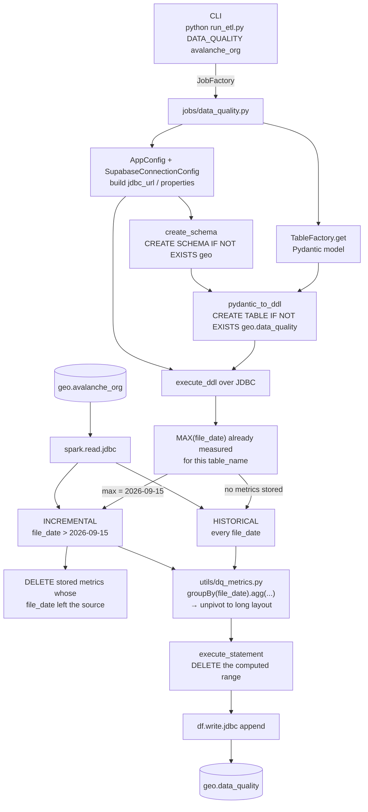

← [README](../README.md)

# Data Quality job

`jobs/data_quality.py` measures one table and stores the results in `geo.data_quality`. Every metric is computed per `file_date` — never for the table as a whole — and each run only touches the `file_date`s it selects ([load type detection](#load-type-detection)), so quality can be tracked over time with plain SQL and no Spark session is needed to read it.

```bash
conda activate geo_etl_311

# Plain table name — no _raw suffix, metrics are measured on the typed table
python run_etl.py DATA_QUALITY avalanche_org
```

> **Note:** `CREATE` and `INGESTION` append `_raw` internally for their own lookups; `DATA_QUALITY` does not — pass the plain table name.

## How it works



1. `run_etl.py` resolves `JobType.DATA_QUALITY` → `jobs/data_quality.py` through `JobFactory` (see [ETL jobs — Job registry](etl-jobs.md#job-registry-and-dispatch)).
2. `TableFactory.get(table_name)` returns the Pydantic model — unknown tables raise `ValueError`.
3. The schema and the `geo.data_quality` table are created if they do not exist.
4. The latest `file_date` already stored for this table picks the [load type](#load-type-detection).
5. Stored metrics whose `file_date` no longer exists in the source are purged.
6. The source table is read over JDBC (filtered to the selected `file_date`s) and `utils/dq_metrics.py` computes every metric in a single `groupBy("file_date").agg(...)` pass, then unpivots the wide frame to the long layout of the `DataQuality` model.
7. The stored rows for exactly that `file_date` range are deleted, then the new rows are appended — re-running the job replaces instead of duplicating.

Expected output (first run):

```
INFO Creating table 'geo.data_quality' if not exists...
INFO No metrics stored for avalanche_org → HISTORICAL: measuring every file_date
INFO Reading geo.avalanche_org...
INFO Computed 126 metrics for 9 file_date(s) in avalanche_org (HISTORICAL)
INFO Replacing stored metrics for avalanche_org...
INFO Writing to geo.data_quality...
INFO Data quality metrics complete: 126 rows written to geo.data_quality
```

Expected output (later runs):

```
INFO Creating table 'geo.data_quality' if not exists...
INFO Latest measured file_date: 2026-09-20 → INCREMENTAL: measuring file_date > 2026-09-20
INFO Purging metrics for file_dates no longer present in geo.avalanche_org...
INFO Reading geo.avalanche_org...
INFO Computed 14 metrics for 1 file_date(s) in avalanche_org (INCREMENTAL)
INFO Replacing stored metrics for avalanche_org...
INFO Writing to geo.data_quality...
INFO Data quality metrics complete: 14 rows written to geo.data_quality
```

When nothing new arrived, the job stops after the purge and writes nothing:

```
INFO Latest measured file_date: 2026-09-20 → INCREMENTAL: measuring file_date > 2026-09-20
INFO Purging metrics for file_dates no longer present in geo.avalanche_org...
INFO Reading geo.avalanche_org...
WARN No new file_date to measure for avalanche_org — metrics are up to date
```

## Load type detection

Same rule as the [INGESTION pipelines](etl-jobs.md#load-type-detection) — no manual flag, decided from the target table:

| Condition | Load Type | Behavior |
|-----------|-----------|----------|
| No metrics stored for this `table_name` | `HISTORICAL` | Measures every `file_date` in the source |
| Metrics stored | `INCREMENTAL` | Measures only `file_date` newer than the stored maximum, and purges metrics for `file_date`s that disappeared from the source |

Notes:

- Metrics are always **per `file_date`** — the job never computes one figure for the table as a whole.
- Only the selected `file_date`s are read, deleted and rewritten; older stored rows are left untouched.
- `MAX(file_date)` on the stored metrics is read through a JDBC subquery, so an empty or unreadable metrics table simply falls back to `HISTORICAL`.
- Supabase is reached through its pooler over the network, so a JDBC call can fail transiently (socket timeout, unresolved host). The job retries such connection errors up to 3 times with a 5 s pause — `utils/jdbc_retry.py` — and always retries the `DELETE` and the append **together**, so an interrupted write cannot leave partial or duplicated metrics behind.
- To force a full remeasure, delete this table's rows — the next run is `HISTORICAL` again:

```sql
DELETE FROM geo.data_quality WHERE table_name = 'avalanche_org';
```

## Metric families

Each row of `geo.data_quality` is one metric value for one `file_date`:

| Metric | Meaning |
|--------|---------|
| `total_records` | Number of rows in the `file_date`. |
| `null_pct__<column>` | Share of rows where `<column>` is NULL — one metric per column. |
| `bad_pct__<rule>` | Share of rows violating a rule — one metric per rule. |
| `bad_row_pct` | Share of rows violating *any* rule. |
| `dup_row_pct` | Share of full-row duplicates inside the `file_date`. |
| `unique_row_pct` | Share of distinct rows inside the `file_date`. |

Nulls are reported by `null_pct__*` only. A rule that cannot be evaluated because of a NULL does not count the row as incorrect, so the two metric families never double count.

## Rules

### Model rules (`model_rules`)

Derived from the Pydantic model of the table:

| Rule | Condition |
|------|-----------|
| `not_blank__<column>` | Required `str` columns (other than `file_date`) must not be blank after trimming. |
| `file_date_iso` | `file_date` matches `YYYY-MM-DD`. |

Columns missing from the DataFrame are skipped, so the metric set always matches the actual table.

### Dataset rules (`dataset_rules`)

| Table | Rules |
|-------|-------|
| `eonet_event`, `gdacs_event`, `nifc_fire`, `openmeteo_flood`, `usgs_earthquake`, `usgs_nwis` | `latitude_range`, `longitude_range` |
| `avalanche_org` | `danger_level_domain`, `forecast_order` |
| `ibtracs_cyclone` | `latitude_range` (on `lat`), `longitude_range` (on `lon`), `wmo_wind_non_negative` |
| `nifc_fire` | `acres_non_negative`, `percent_contained_0_100` |
| `openmeteo_flood` | `discharge_non_negative` |
| `eonet_event` | `geometry_count_non_negative` |
| `gdacs_event` | `alert_level_domain` |
| `usgs_volcano` | *(model rules only)* |

Rules whose column is missing from the table are skipped.

`danger_level_domain` accepts the source's `-1` ("no rating") sentinel together with `1`…`5`, so a period where no ratings are published (off-season) is reported as clean instead of 100% bad rows.

## Querying the results

Latest quality snapshot for a table:

```sql
SELECT metric, round(value::numeric, 4) AS value
FROM geo.data_quality
WHERE table_name = 'avalanche_org' AND file_date = '2026-09-20'
ORDER BY metric;
```

Trend of one metric over time:

```sql
SELECT file_date, round(value::numeric, 4) AS bad_row_pct
FROM geo.data_quality
WHERE table_name = 'avalanche_org' AND metric = 'bad_row_pct'
ORDER BY file_date;
```

Tables breaching a threshold:

```sql
SELECT DISTINCT table_name
FROM geo.data_quality
WHERE metric = 'bad_row_pct' AND value > 0.05;
```

## Related code

| File | Role |
|------|------|
| `jobs/data_quality.py` | Load type detection, purge of removed `file_date`s, measure and replace |
| `utils/dq_metrics.py` | Rules, metric computation and unpivoting |
| `model/other/data_quality.py` | `DataQuality` model — the row layout of `geo.data_quality` |
| `utils/jdbc_retry.py` | Bounded retry for transient pooler connection failures |
| `utils/ddl_generator.py` | `execute_statement` runs the `DELETE`s over JDBC |
| `test/jobs/test_data_quality.py` | Job flow for both load types, purge, empty/no-new-data paths |
| `test/util/test_dq_metrics.py` | Metrics verified against a real local Spark session |
