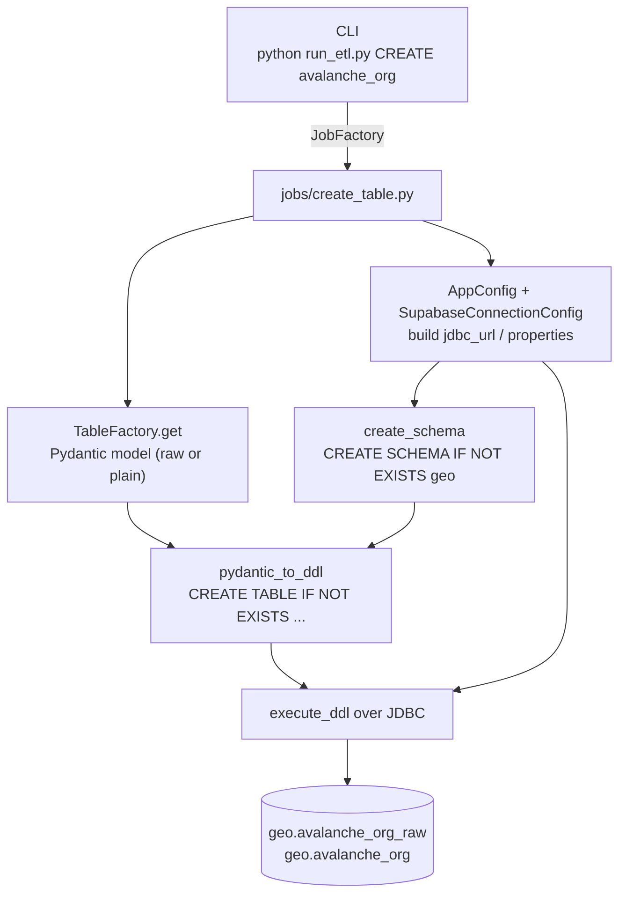
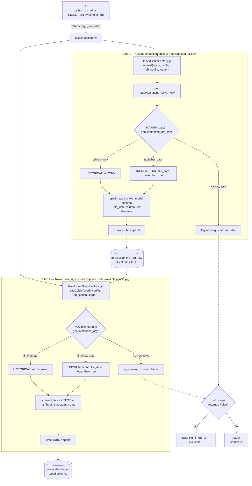

← [README](../README.md)

# ETL Jobs

`run_etl.py` is the main CLI entry point. It dispatches jobs through a registry, so adding a new job type means registering a module in `factory/job_factory.py` — no changes to the CLI itself.

## Job registry and dispatch

`JobFactory` (`factory/job_factory.py`) maps a job type from the `JobType` enum (`model/enums.py`) to its module in `jobs/`:

| Job Type | Module | What it does |
|----------|--------|--------------|
| `CREATE` | `jobs/create_table.py` | Creates the schema and the tables from Pydantic DDL |
| `INGESTION` | `jobs/ingestion.py` | Upload CSVs → raw table, then raw → typed table |
| `DATA_QUALITY` | `jobs/data_quality.py` | Computes per-`file_date` quality metrics into `geo.data_quality` |

Every run:

1. Reads `config.json` (Spark master, DB schema, JDBC driver) and `supabase_config.json` (credentials).
2. Creates a Spark session connected to the cluster and registers the stage memory logger (see [Logging](logging.md#stage-memory-monitoring)).
3. Resolves the job type to its module and executes it, passing the table name, config objects and logger.
4. Stops the Spark session.

```bash
python run_etl.py CREATE avalanche_org
python run_etl.py INGESTION avalanche_org
python run_etl.py DATA_QUALITY avalanche_org
```

## CREATE TABLE job

`jobs/create_table.py` — schema + table DDL generated from the Pydantic models:



How the data flows:

1. `run_etl.py` parses the CLI args and resolves `JobType.CREATE` → `jobs/create_table.py` through `JobFactory` (see [Job registry and dispatch](#job-registry-and-dispatch)).
2. `TableFactory.get(table_name)` returns the Pydantic model registered for the table — raw models produce all-TEXT columns, plain models produce typed columns. Unknown tables raise `ValueError`.
3. `AppConfig.from_json()` and `SupabaseConnectionConfig.from_json()` build the JDBC URL and properties used by every database call below.
4. `create_schema` creates the target schema (`geo` by default) if it does not exist.
5. `pydantic_to_ddl` (`utils/ddl_generator.py`) turns the model into a `CREATE TABLE IF NOT EXISTS` statement.
6. `execute_ddl` runs that statement against Supabase over JDBC — the table is ready for the [INGESTION job](#ingestion-job).

Spark schemas are derived from the same models via `utils/schema_converter.py` (Pydantic → `StructType`), so DDL, Spark schema and validation always agree.

```
INFO Creating schema 'geo' if not exists...
INFO Schema 'geo' ready
INFO Generated DDL for geo.avalanche_org_raw
INFO Executing DDL against Supabase...
INFO Table geo.avalanche_org_raw created.
```

## INGESTION job

`jobs/ingestion.py` runs the two pipelines in order via the factories — CSVs land in the raw table, typed rows in the plain table:



How the data flows:

1. `run_etl.py` appends the `_raw` suffix to the table name (unless you already passed one), resolves `JobType.INGESTION` → `jobs/ingestion.py`, and creates a single logger — both steps write to the same `logs/ingestion/ingestion_<table>_<timestamp>.log`.
2. **Upload** — `UploadScriptFactory` picks the upload script for the table; CSVs from `data.directory` are read one by one, stamped with `file_date` from the filename, unioned and appended to the raw table.
3. **Raw2Plain** — `Raw2PlainScriptFactory` picks the transform; only raw rows newer than the latest `file_date` in the plain table are read, passed through the dataset-specific `convert_fn`, and appended to the plain table.
4. Both steps decide [Load type detection](#load-type-detection) from the state of their target table — no manual flag. A step that finds no new data logs a warning and returns `False`; **when both steps return `False` the job raises `RuntimeError`** (`No new data to ingest for <table>`), so `run_etl.py` exits with code 1 and a chained GEO_E2E run stops. If either step wrote anything the job still finishes successfully — e.g. raw rows left by an earlier crash are transformed even though no new file arrived.

Details of each step: [Upload pipeline](#upload-pipeline) · [Raw2Plain pipeline](#raw2plain-pipeline).

## DATA_QUALITY job

`jobs/data_quality.py` measures a plain table and stores one row per `(table_name, file_date, metric)` in `geo.data_quality`:

1. Resolves the Pydantic model for the table (no `_raw` suffix is appended — pass the plain table name).
2. Creates the `geo` schema and the `geo.data_quality` table if they do not exist.
3. Reads the latest stored `file_date` for this table and picks the [load type](#load-type-detection) — `HISTORICAL` (nothing measured yet → every `file_date`) or `INCREMENTAL` (only `file_date` newer than the stored maximum).
4. Purges stored metrics whose `file_date` no longer exists in the source.
5. Reads the source table for the selected `file_date`s and computes all metrics in a single `groupBy(...).agg(...)` pass (`utils/dq_metrics.py`).
6. Deletes the stored rows for exactly that range, then appends the freshly computed ones — re-running the job replaces instead of duplicating.

Transient connection failures (socket timeout, unresolved host) are retried up to 3 times with a 5 s pause, and the delete and the append are retried as a single unit — `utils/jdbc_retry.py`.

```
INFO Creating table 'geo.data_quality' if not exists...
INFO No metrics stored for avalanche_org → HISTORICAL: measuring every file_date
INFO Reading geo.avalanche_org...
INFO Computed 126 metrics for 9 file_date(s) in avalanche_org (HISTORICAL)
INFO Replacing stored metrics for avalanche_org...
INFO Writing to geo.data_quality...
INFO Data quality metrics complete: 126 rows written to geo.data_quality
```

Metric families, the rules behind `bad_pct__*`, load type details and example SQL: see [Data Quality job](data-quality.md).

## Load type detection

The INGESTION pipelines and the DATA_QUALITY job decide their load type from the state of their target table — no manual flag is needed.

### Upload

| Condition | Load Type | Behavior |
|-----------|-----------|----------|
| Table is empty | `HISTORICAL` | Uploads all CSV files |
| Table has data | `INCREMENTAL` | Uploads only CSVs with `file_date` newer than the latest in the table |
| No file newer than the table's max | `INCREMENTAL` | Warns, writes nothing, returns `False` |

### Raw2Plain

| Condition | Load Type | Behavior |
|-----------|-----------|----------|
| Final table is empty | `HISTORICAL` | Processes all raw data |
| Final table has data | `INCREMENTAL` | Processes only raw rows with `file_date` > max in final |
| No raw row newer than the final max | `INCREMENTAL` | Warns, writes nothing, returns `False` |

### DATA_QUALITY

| Condition | Load Type | Behavior |
|-----------|-----------|----------|
| No metrics stored for this table | `HISTORICAL` | Measures every `file_date` in the source |
| Metrics stored | `INCREMENTAL` | Measures only `file_date` > the stored maximum, and purges metrics whose `file_date` left the source |

Details: [Data Quality job — Load type detection](data-quality.md#load-type-detection).

**INGESTION fails when there is nothing to ingest** — both steps warn, and because neither wrote anything the job raises, so `run_etl.py` exits with code 1 (the E2E chain then logs a warning and skips `DATA_QUALITY`):

```
WARNING No new files to upload for avalanche_org_raw — nothing to do, table is up to date
WARNING No new records to process for avalanche_org_raw — nothing to do, table is up to date
WARNING No new data to ingest for avalanche_org_raw — no file newer than the latest file_date
ERROR ETL job failed   (RuntimeError)   → exit code 1
```

A step that *did* have work keeps the job green: raw rows left behind by an earlier crash are transformed even when no new file arrived.

**DATA_QUALITY** keeps the opposite behaviour — with no new `file_date` to measure it warns and still finishes successfully, so an unchanged chain never fails on the quality step:

```
logger.warning("No new file_date to measure for avalanche_org — metrics are up to date")
```

To exercise the INCREMENTAL path, follow the [incremental test workflow](usage.md#incremental-test-workflow).

## Upload pipeline

Upload CSV files from GEO_Download to a Supabase table (`ingestion/upload/` scripts are thin wrappers around `utils/upload_utils.py`):

```python
from pyspark.sql import SparkSession
from model.config import AppConfig, SupabaseConnectionConfig
from ingestion.upload.avalanche_org_upload import upload

config = AppConfig.from_json()
db_config = SupabaseConnectionConfig.from_json()
spark = SparkSession.builder.master("spark://localhost:7078").appName("upload").getOrCreate()

upload(spark, config, db_config, "avalanche_org_raw", AvalancheOrgRaw, "Avalanche_ORG")
spark.stop()
```

When called from the INGESTION job, a logger is passed so all logs go to the same file:

```python
upload(spark, config, db_config, logger=my_logger)
```

Expected output:

```
---- Upload started: avalanche_org_raw (HISTORICAL) ----
Data directory: /path/to/GEO_Download/data/Avalanche_ORG
HISTORICAL: reading all 19 CSV files
Writing to geo.avalanche_org_raw...
Upload complete: 19 files written to geo.avalanche_org_raw
Spark session stopped
```

## Raw2Plain pipeline

Convert data from `avalanche_org_raw` (all TEXT) to `avalanche_org` (typed: int, bool, datetime, date) (`ingestion/raw2plain/` scripts are thin wrappers around `utils/raw2plain_utils.py`):

```python
from pyspark.sql import SparkSession
from model.config import AppConfig, SupabaseConnectionConfig
from ingestion.raw2plain.avalanche_org_raw2plain import raw2plain

config = AppConfig.from_json()
db_config = SupabaseConnectionConfig.from_json()
spark = SparkSession.builder.master("spark://localhost:7078").appName("raw2plain").getOrCreate()

raw2plain(spark, config, db_config, "avalanche_org_raw", "avalanche_org", convert_fn)
spark.stop()
```

When called from the INGESTION job, a logger is passed so all logs go to the same file:

```python
raw2plain(spark, config, db_config, logger=my_logger)
```

**Type conversions applied (Avalanche_ORG):**

| Column | Raw Type | Final Type |
|--------|----------|------------|
| `zone_id` | TEXT | INTEGER |
| `danger_level` | TEXT | INTEGER |
| `off_season` | TEXT | BOOLEAN |
| `forecast_start` | TEXT | TIMESTAMP |
| `forecast_end` | TEXT | TIMESTAMP |
| `date` | TEXT | DATE |

## Memory Optimization

The upload and raw2plain pipelines are optimized for memory efficiency:

### Upload (`utils/upload_utils.py`)
- **No pre-count**: Removed `df.count()` before write — avoids forcing full DataFrame materialization just for a log message
- **Incremental union**: Builds the union chain without storing intermediates in a list, allowing GC to collect frames as they're merged
- **Schema hoisted**: `pydantic_to_spark_schema()` called once outside the CSV loop instead of per-file

### Raw2Plain (`utils/raw2plain_utils.py`)
- **Lightweight empty check**: `raw_df.head(1)` instead of `raw_df.count()` — avoids full table scan just to check if data exists

### Design Decisions
- Upload and raw2plain each read from JDBC once (no double scans)
- Pydantic models are lightweight at import time (~KB each); eager loading is acceptable
- `findspark.init()` is idempotent; called at module import for simplicity
