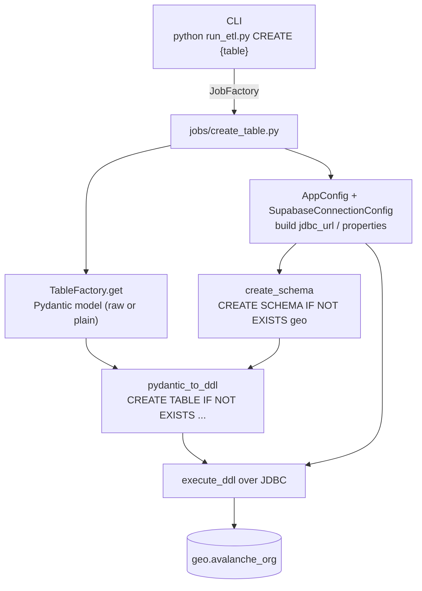

← [ETL jobs](../etl-jobs.md)

# CREATE TABLE job

`jobs/create_table.py` — schema + table DDL generated from the Pydantic models:



One run creates **one** table: `jobs/create_table.py` builds a single `CREATE TABLE` statement for the exact `table_name` it is given. The raw (`geo.avalanche_org_raw`) and the plain (`geo.avalanche_org`) tables are therefore created by two separate `CREATE` runs.

How the data flows:

1. `run_etl.py` parses the CLI args and resolves `JobType.CREATE` → `jobs/create_table.py` through `JobFactory` (see [Job registry and dispatch](../etl-jobs.md#job-registry-and-dispatch)).
2. `TableFactory.get(table_name)` returns the Pydantic model registered for the table — raw models produce all-TEXT columns, plain models produce typed columns. Unknown tables raise `ValueError`.
3. `AppConfig.from_json()` and `SupabaseConnectionConfig.from_env()` build the JDBC URL and properties used by every database call below.
4. `create_schema` creates the target schema (`geo` by default) if it does not exist.
5. `pydantic_to_ddl` (`utils/ddl_generator.py`) turns the model into a `CREATE TABLE IF NOT EXISTS` statement.
6. `execute_ddl` runs that statement against Supabase over JDBC — the table is ready for the [INGESTION job](ingestion.md).

Spark schemas are derived from the same models via `utils/schema_converter.py` (Pydantic → `StructType`), so DDL, Spark schema and validation always agree.

Log lines written to `logs/create/create_<table_name>_<timestamp>.log` (logger output — nothing is printed to the terminal):

```
INFO Creating schema 'geo' if not exists...
INFO Schema 'geo' ready
INFO Generated DDL for geo.avalanche_org
INFO Executing DDL against Supabase...
INFO Table geo.avalanche_org created.
```

