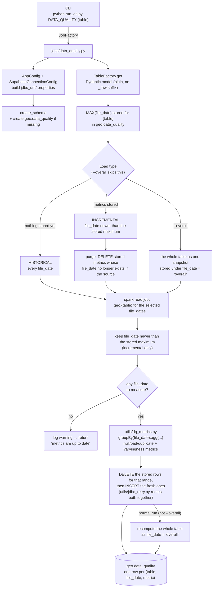

← [ETL jobs](../etl-jobs.md)

# DATA_QUALITY job

`jobs/data_quality.py` measures one table and stores one row per `(table_name, file_date, metric)` in `geo.data_quality`. Every metric is computed per `file_date` — never for the table as a whole — and each run only touches the `file_date`s it selects ([load type detection](#load-type-detection)), so quality can be tracked over time with plain SQL and no Spark session is needed to read it.

A **normal run also refreshes the whole-table `overall` snapshot** (stored under `file_date = 'overall'`) after writing the dated metrics, so the aggregate never falls behind the dated rows it summarizes — see [Overall refresh](#overall-refresh). The `--overall` flag selects a snapshot-only run that measures the whole table and leaves the per-`file_date` rows untouched.

```bash
conda activate geo_etl_311

# Plain table name — no _raw suffix, metrics are measured on the typed table
python run_etl.py DATA_QUALITY <table_name>

# Whole table as one snapshot, stored under file_date = 'overall'
python run_etl.py DATA_QUALITY <table_name> --overall
```

> **Note:** `INGESTION` appends `_raw` internally for its own lookups, `CREATE` takes the exact table name it is given, and `DATA_QUALITY` adds nothing — pass the plain table name.

## How it works



How the data flows:

1. `run_etl.py` resolves `JobType.DATA_QUALITY` → `jobs/data_quality.py` through `JobFactory` (see [Job registry and dispatch](../etl-jobs.md#job-registry-and-dispatch)).
2. `TableFactory.get(table_name)` returns the Pydantic model — unknown tables raise `ValueError`.
3. The `geo` schema and the `geo.data_quality` table are created if they do not exist.
4. The latest `file_date` already stored for this table picks the [load type](#load-type-detection).
5. Stored metrics whose `file_date` no longer exists in the source are purged.
6. The source table is read over JDBC (filtered to the selected `file_date`s) and `utils/dq_metrics.py` computes every metric in a single `groupBy("file_date").agg(...)` pass, then unpivots the wide frame to the long layout of the `DataQuality` model.
7. The stored rows for exactly that `file_date` range are deleted, then the new rows are appended — re-running the job replaces instead of duplicating.
8. On a normal run, the whole table is then recomputed as one `overall` group and the stored `file_date = 'overall'` rows are replaced (see [Overall refresh](#overall-refresh)).

Transient connection failures (socket timeout, unresolved host) are retried up to 3 times with a 5 s pause, and the `DELETE` and the append are retried as a single unit — `utils/jdbc_retry.py` — so an interrupted write cannot leave partial or duplicated metrics behind.

## Load type detection

The decision table is shared with the other pipelines: [Load type detection — DATA_QUALITY](load-types.md#data_quality). What matters for this job:

- Dated metrics are always **per `file_date`** — only the selected `file_date`s are read, deleted and rewritten; older stored rows are left untouched. (The `overall` snapshot is refreshed separately — see [Overall refresh](#overall-refresh).)
- `MAX(file_date)` on the stored metrics is read through a JDBC subquery, so an empty or unreadable metrics table simply falls back to `HISTORICAL`.
- To force a full remeasure, delete this table's rows — the next run is `HISTORICAL` again:

```sql
DELETE FROM geo.data_quality WHERE table_name = 'avalanche_org';
```

## Overall refresh

A **normal run refreshes the `overall` snapshot automatically**: after it writes the dated metrics for any new `file_date`s, it recomputes the **whole table** as one group and replaces the stored `file_date = 'overall'` rows (only those — the dated rows are untouched). This is what keeps the aggregate in `geo.data_quality` from falling behind the dated rows it summarizes, which is exactly the staleness the `overall` snapshot used to suffer when only the dated rows were updated.

- The refresh runs whenever a normal run measured new `file_date`s. When nothing new arrived, the job stops after the purge (no dated metrics, no overall refresh) — the existing `overall` already matches the unchanged table.
- The two row families stay disjoint: the dated deletes exclude `'overall'`, and the refresh only deletes and rewrites `'overall'` rows.
- The refresh recomputes the whole table, so it costs one extra full-table pass per normal run. The tables are small (thousands of rows), so this is cheap relative to the correctness it guarantees.

## Overall mode

`--overall` measures **every row of the table as one group**, regardless of `file_date`, and stores the result under the sentinel `file_date = 'overall'` — it skips the load type detection, the dated metrics and the purge, so only the `overall` rows are written and the per-`file_date` history stays untouched. Use it to refresh *just* the aggregate without touching the dated history (a normal run already keeps both in step):

```bash
python run_etl.py DATA_QUALITY <table_name> --overall
```

| | Normal run (default) | `--overall` run |
|---|---|---|
| Dated metrics (per `file_date`) | yes — new `file_date`s only | skipped |
| `overall` snapshot | refreshed after the dated metrics | written (only) |
| Grouping | one metric set per `file_date`, then one for the whole table | one metric set for the whole table |
| Load type detection | HISTORICAL / INCREMENTAL | skipped |
| Purge of vanished dates | yes | no |
| Replaces | its own `file_date` range, then the `overall` rows | the stored `overall` rows |

Notes:

- The two modes own disjoint rows. The dated deletes exclude `overall` rows, and the `overall` refresh (normal or `--overall`) only replaces `overall` rows — the per-`file_date` history is never touched by an aggregate write.
- Existing `overall` rows are deleted and recalculated on every refresh, so the snapshot can never go stale or duplicate. To drop a snapshot instead of refreshing it:

```sql
DELETE FROM geo.data_quality WHERE table_name = 'avalanche_org' AND file_date = 'overall';
```

- The `file_date_iso` rule does not apply to the `overall` group — the grouping key is the sentinel, not a date — so it is left out of the metric set and `bad_row_pct` is not inflated. `null_pct__file_date` is `0` by construction, and `distinct__file_date` is never emitted because `file_date` is the grouping key.
- The stored-date probe ignores `overall` rows (they are not dates), so a table holding only a snapshot still measures as `HISTORICAL` on its first normal run.

## Expected log file content

Written to `logs/data_quality/data_quality_<table>_<timestamp>.log` (the job's logger writes to the file and mirrors to stdout — `run_etl.py` itself prints nothing extra):

First run (every `file_date`, plus the `overall` refresh):

```
INFO Creating table 'geo.data_quality' if not exists...
INFO No metrics stored for avalanche_org → HISTORICAL: measuring every file_date
INFO Reading geo.avalanche_org...
INFO Computed 657 metrics for 9 file_date(s) in avalanche_org (HISTORICAL)
INFO Replacing stored metrics for avalanche_org...
INFO Writing to geo.data_quality...
INFO Data quality metrics complete: 657 rows written to geo.data_quality
INFO Refreshing overall snapshot for avalanche_org...
INFO Writing to geo.data_quality...
INFO Overall snapshot refreshed: 73 metrics for avalanche_org
```

Later runs (only the new `file_date`s, plus the `overall` refresh):

```
INFO Creating table 'geo.data_quality' if not exists...
INFO Latest measured file_date: 2026-09-20 → INCREMENTAL: measuring file_date > 2026-09-20
INFO Purging metrics for file_dates no longer present in geo.avalanche_org...
INFO Reading geo.avalanche_org...
INFO Computed 73 metrics for 1 file_date(s) in avalanche_org (INCREMENTAL)
INFO Replacing stored metrics for avalanche_org...
INFO Writing to geo.data_quality...
INFO Data quality metrics complete: 73 rows written to geo.data_quality
INFO Refreshing overall snapshot for avalanche_org...
INFO Writing to geo.data_quality...
INFO Overall snapshot refreshed: 73 metrics for avalanche_org
```

When nothing new arrived, the job stops after the purge and writes nothing (exit code `0`):

```
INFO Latest measured file_date: 2026-09-20 → INCREMENTAL: measuring file_date > 2026-09-20
INFO Purging metrics for file_dates no longer present in geo.avalanche_org...
INFO Reading geo.avalanche_org...
WARN No new file_date to measure for avalanche_org — metrics are up to date
```

## Related docs

Metric families, the rules behind `bad_pct__*`, range and distribution metrics and example SQL: see [Data Quality metrics](../data-quality-metrics.md).
