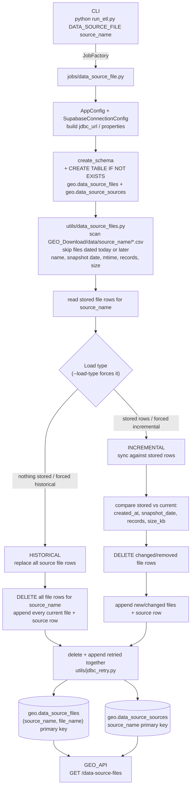

← [ETL jobs](../etl-jobs.md)

# DATA_SOURCE_FILE job

`jobs/data_source_file.py` publishes one GEO_Download source's CSV inventory to
`geo.data_source_files` and its source-registry row to `geo.data_source_sources`. It is the
Spark-side producer for GEO_API's [Data Source Files](../../../GEO_APP/README.md#features) view;
the API only reads the tables, so it never mounts `GEO_Download/data`.

```bash
conda activate geo_etl_311

# Auto-detect HISTORICAL / INCREMENTAL
python run_etl.py DATA_SOURCE_FILE <source_name>

# Force a full refresh
python run_etl.py DATA_SOURCE_FILE <source_name> --load-type historical

# Force an incremental sync
python run_etl.py DATA_SOURCE_FILE <source_name> --load-type incremental
```

`<source_name>` is the source folder under `GEO_Download/data` — the same value as the
`source_name` of the DAG's `DOWNLOAD-<source>` job (`EONET`, `USGS_Earthquake`, …).

## How it works



How the data flows:

1. `run_etl.py` resolves `JobType.DATA_SOURCE_FILE` → `jobs/data_source_file.py`.
2. `utils/data_source_files.py` scans `GEO_Download/data/<source_name>/*.csv` on the
   Airflow/Spark driver (which has the data folder mounted) and computes one row per file:
   file name, snapshot date from the filename, filesystem modification time, record count
   (header and blank lines excluded), size in kB, and the pipeline start date from
   `GEO_Download/config.json`. Files dated **today or later** are skipped — the downloader
   writes one file per previous day, so only dates strictly before the current date are part
   of the finished inventory.
3. It creates `geo.data_source_files` and `geo.data_source_sources` if missing and reads the
   stored file rows for the source.
4. It selects the load type:
   - **HISTORICAL** when no file rows are stored for the source (or `--load-type historical`):
     replace every file row for the source with the current folder contents.
   - **INCREMENTAL** when file rows exist (or `--load-type incremental`): write only new or
     changed files, delete files that vanished from the folder, and refresh the source row.
5. The file delete + append and the source-row refresh are retried together as one idempotent
   unit (`utils/jdbc_retry.py`), so an interrupted write cannot duplicate or partially replace
   the source metadata.

`geo.data_source_files` has a composite `(source_name, file_name)` primary key and contains
real CSV files only. `geo.data_source_sources` holds one row per source folder (`source_name`,
`pipeline_start_date`, `updated_at`), so a source with no current files still appears in
GEO_API's dropdown.

## HISTORICAL vs INCREMENTAL

| | HISTORICAL | INCREMENTAL |
|---|---|---|
| When | no stored file rows for the source, or forced | stored file rows exist, or forced |
| File scan | every CSV in the source folder | every CSV in the source folder (compared with stored rows) |
| Writes | every current file row + source row | new/changed file rows + source row |
| Removes | all previous source file rows first | vanished file rows |
| Re-running | replaces the source metadata | converges to the current folder contents |

A changed file is one whose `created_at`, `snapshot_date`, `records` or `size_kb` differs
from the stored row. This catches re-downloaded/backfilled files, not just new dates.

## Expected log file content

Written to `logs/data_source_file/data_source_file_<source>_<timestamp>.log` (the job logger
writes to the file and mirrors to stdout):

First run:

```
INFO Creating tables 'geo.data_source_files' and 'geo.data_source_sources'...
INFO No stored files for EONET → HISTORICAL: replacing 0 row(s) with 62 file(s)
INFO Data source file metadata complete: 62 written, 0 removed for EONET (HISTORICAL)
```

Later run with one new file:

```
INFO Creating tables 'geo.data_source_files' and 'geo.data_source_sources'...
INFO Stored files exist for EONET → INCREMENTAL: 1 new/changed file(s), 0 removed file(s)
INFO Data source file metadata complete: 1 written, 0 removed for EONET (INCREMENTAL)
```

## DAG wiring

In GEO_E2E every source's `DOWNLOAD-<source>` job lists both `INGESTION-<table>` and
`DATA_SOURCE_FILE-<source>` in `next_jobs`. The metadata job therefore starts after a
successful download, in parallel with ingestion, and has no successor of its own — like the
source `DATA_QUALITY` jobs, it is a terminal branch that the final `Union.verdict` task waits
on.
