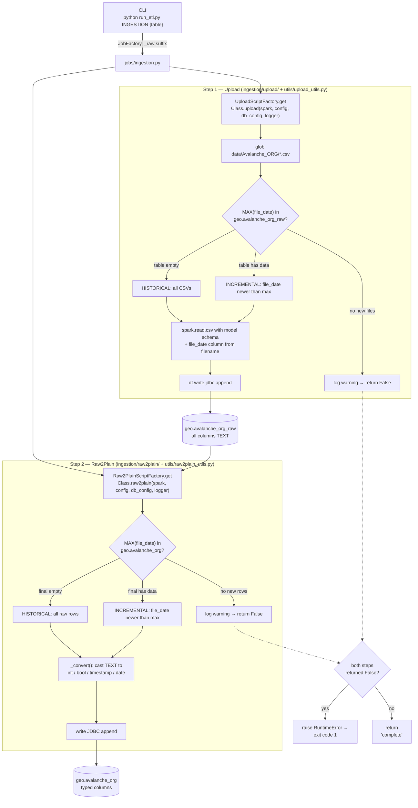

← [ETL jobs](../etl-jobs.md)

# INGESTION job

`jobs/ingestion.py` runs the two pipelines in order via the factories — CSVs land in the raw table, typed rows in the plain table:



How the data flows:

1. `run_etl.py` appends the `_raw` suffix to the table name (unless you already passed one), resolves `JobType.INGESTION` → `jobs/ingestion.py`, and creates a single logger — both steps write to the same `logs/ingestion/ingestion_<table>_<timestamp>.log`.
2. **Upload** — `UploadScriptFactory` picks the script instance for the table; CSVs from `data.directory` are read one by one, stamped with `file_date` from the filename, unioned and appended to the raw table.
3. **Raw2Plain** — `Raw2PlainScriptFactory` picks the script instance; only raw rows newer than the latest `file_date` in the plain table are read, passed through the script's `_convert()` method, and appended to the plain table.
4. Both steps decide [Load type detection](load-types.md) from the state of their target table — no manual flag. A step that finds no new data logs a warning and returns `False`; **when both steps return `False` the job raises `RuntimeError`** (`No new data to ingest for <table>`), so `run_etl.py` exits with code 1 and a chained GEO_E2E run stops. If either step wrote anything the job still finishes successfully — e.g. raw rows left by an earlier crash are transformed even though no new file arrived.

Details of each step: [Upload pipeline](#upload-pipeline) · [Raw2Plain pipeline](#raw2plain-pipeline).

## Upload pipeline

Upload CSV files from GEO_Download to a Supabase table (`ingestion/upload/` scripts are classes implementing `ingestion/upload/upload_script.py`):

```python
from pyspark.sql import SparkSession
from model.config import AppConfig, SupabaseConnectionConfig
from ingestion.upload.avalanche_org_upload import AvalancheOrgUploadScript

config = AppConfig.from_json()
db_config = SupabaseConnectionConfig.from_json()
spark = SparkSession.builder.master("spark://localhost:7078").appName("upload").getOrCreate()

AvalancheOrgUploadScript().upload(spark, config, db_config)
spark.stop()
```

When called from the INGESTION job, a logger is passed so all logs go to the same file:

```python
script.upload(spark, config, db_config, logger=my_logger)
```

Expected log file content — `logs/upload/upload_<table>_<timestamp>.log` when run standalone, `logs/ingestion/ingestion_<table>_<timestamp>.log` when called from the INGESTION job (the logger writes only to the file):

```
---- Upload started: avalanche_org_raw ----
Data directory: /path/to/GEO_Download/data/Avalanche_ORG
Found 33 CSV files
Table empty → HISTORICAL: loading all files
Writing to geo.avalanche_org_raw...
Upload complete: 33 files written to geo.avalanche_org_raw
```

`Found N CSV files` counts everything in the data folder; when the table already has data the next lines become `Latest file_date in table: <date> → INCREMENTAL` and `<n> new files to upload` instead of the `Table empty` line (file counts are illustrative — they grow with every GEO_Download run).

## Raw2Plain pipeline

Convert data from `avalanche_org_raw` (all TEXT) to `avalanche_org` (typed: int, bool, datetime, date) (`ingestion/raw2plain/` scripts are classes implementing `ingestion/raw2plain/raw2plain_script.py`):

```python
from pyspark.sql import SparkSession
from model.config import AppConfig, SupabaseConnectionConfig
from ingestion.raw2plain.avalanche_org_raw2plain import AvalancheOrgRaw2PlainScript

config = AppConfig.from_json()
db_config = SupabaseConnectionConfig.from_json()
spark = SparkSession.builder.master("spark://localhost:7078").appName("raw2plain").getOrCreate()

AvalancheOrgRaw2PlainScript().raw2plain(spark, config, db_config)
spark.stop()
```

When called from the INGESTION job, a logger is passed so all logs go to the same file:

```python
script.raw2plain(spark, config, db_config, logger=my_logger)
```

**Type conversions applied (Avalanche_ORG):**

| Column | Raw Type | Final Type |
|--------|----------|------------|
| `zone_id` | TEXT | INTEGER |
| `danger_level` | TEXT | INTEGER |
| `off_season` | TEXT | BOOLEAN |
| `forecast_start` | TEXT | TIMESTAMP |
| `forecast_end` | TEXT | TIMESTAMP |
| `date` | TEXT | DATE |
| `latitude` | TEXT | DOUBLE |
| `longitude` | TEXT | DOUBLE |

## Memory Optimization

The upload and raw2plain pipelines are optimized for memory efficiency:

### Upload (`utils/upload_utils.py`)
- **No pre-count**: Removed `df.count()` before write — avoids forcing full DataFrame materialization just for a log message
- **Incremental union**: Builds the union chain without storing intermediates in a list, allowing GC to collect frames as they're merged
- **Schema hoisted**: `pydantic_to_spark_schema()` called once outside the CSV loop instead of per-file

### Raw2Plain (`utils/raw2plain_utils.py`)
- **Lightweight empty check**: `raw_df.head(1)` instead of `raw_df.count()` — avoids full table scan just to check if data exists

### Design Decisions
- Upload and raw2plain each read from JDBC once (no double scans)
- Pydantic models are lightweight at import time (~KB each); eager loading is acceptable
- `findspark.init()` is idempotent; called at module import for simplicity
