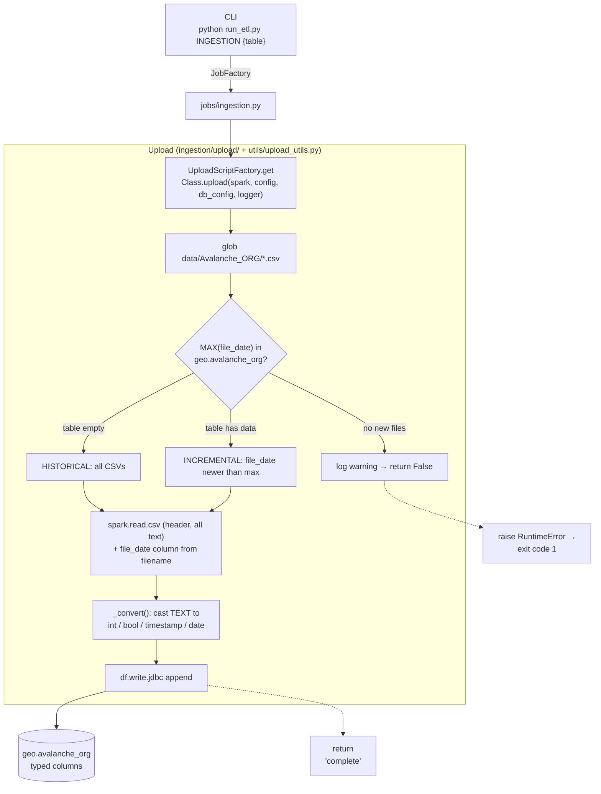

← [ETL jobs](../etl-jobs.md)

# INGESTION job

`jobs/ingestion.py` converts one source's CSV files and appends the typed rows directly to its plain table — there is no intermediate raw table:



How the data flows:

1. `run_etl.py` resolves `JobType.INGESTION` → `jobs/ingestion.py` and creates a single logger (`logs/ingestion/ingestion_<table>_<timestamp>.log`).
2. **Upload** — `UploadScriptFactory` picks the script instance for the plain table. The script's `_convert()` method casts the CSV text columns to the plain table's types.
3. The shared runner in `utils/upload_utils.py` reads only CSVs newer than the latest `file_date` in the target table, stamps each row with the `file_date` parsed from its filename, unions the files and appends the converted rows in one JDBC write.
4. Load type is detected from the target table — no manual flag. When no file is newer than the table's latest `file_date`, the step logs a warning and returns `False`; the job then raises `RuntimeError` (`No new data to ingest for <table>`), so `run_etl.py` exits with code 1 and a chained GEO_E2E run stops.

> The CSV inventory is published by the separate [DATA_SOURCE_FILE job](data-source-file.md),
> which runs after `DOWNLOAD` in the DAG and is not part of `INGESTION`.

## Upload pipeline

Upload CSV files from GEO_Download directly into a typed Supabase table (`ingestion/upload/` scripts are classes implementing `ingestion/upload/upload_script.py`):

```python
from pyspark.sql import SparkSession
from model.config import AppConfig, SupabaseConnectionConfig
from ingestion.upload.avalanche_org_upload import AvalancheOrgUploadScript

config = AppConfig.from_json()
db_config = SupabaseConnectionConfig.from_env()
spark = SparkSession.builder.master("spark://localhost:7078").appName("upload").getOrCreate()

AvalancheOrgUploadScript().upload(spark, config, db_config)
spark.stop()
```

When called from the INGESTION job, a logger is passed so all logs go to the same file:

```python
script.upload(spark, config, db_config, logger=my_logger)
```

Expected log file content — `logs/upload/upload_<table>_<timestamp>.log` when run standalone, `logs/ingestion/ingestion_<table>_<timestamp>.log` when called from the INGESTION job (the logger writes to the file and mirrors to stdout):

```
---- Upload started: avalanche_org ----
Data directory: /path/to/GEO_Download/data/Avalanche_ORG
Found 33 CSV files
Table empty → HISTORICAL: loading all files
Writing to geo.avalanche_org...
Upload complete: 33 files written to geo.avalanche_org
```

`Found N CSV files` counts everything in the data folder; when the table already has data the next lines become `Latest file_date in table: <date> → INCREMENTAL` and `<n> new files to upload` instead of the `Table empty` line (file counts are illustrative — they grow with every GEO_Download run).

**Type conversions applied (Avalanche_ORG):**

| Column | CSV Type | Plain Type |
|--------|----------|------------|
| `zone_id` | TEXT | INTEGER |
| `danger_level` | TEXT | INTEGER |
| `off_season` | TEXT | BOOLEAN |
| `forecast_start` | TEXT | TIMESTAMP |
| `forecast_end` | TEXT | TIMESTAMP |
| `date` | TEXT | DATE |
| `latitude` | TEXT | DOUBLE |
| `longitude` | TEXT | DOUBLE |

Each source has its own `_convert()` in its upload script — the columns, casts and aliases are kept next to the source's dataset wiring in `config.json`.

## Memory Optimization

The upload pipeline is optimized for memory efficiency:

- **No pre-count**: no `df.count()` before write — avoids forcing full DataFrame materialization just for a log message
- **Incremental union**: builds the union chain without storing intermediates in a list, allowing GC to collect frames as they're merged
- **One write**: all new CSV files are unioned and appended in a single JDBC write
- **No raw round-trip**: CSVs are converted in memory and written once, so Supabase stores only the typed rows

### Design Decisions

- The upload script reads CSVs without an explicit schema (all text) and casts them in `_convert()`, so source files with extra columns (e.g. the full IBTrACS track) are handled by name
- Pydantic models are lightweight at import time (~KB each); eager loading is acceptable
- `findspark.init()` is idempotent; called at module import for simplicity
