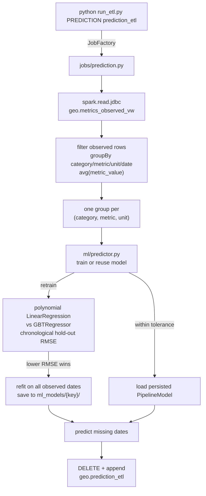

← [ETL jobs](../etl-jobs.md)

# PREDICTION job

`jobs/prediction.py` fills dates where the observed metric views have no value.
It trains one PySpark MLlib model per
`(event_category, metric_name, metric_unit)` over the daily observations derived
from `geo.union_etl`, compares a polynomial linear model with a gradient-boosted
tree model, keeps the better one, and rebuilds `geo.prediction_etl` from scratch
on every run.

Predicted rows are deliberately **not** written to `geo.union_etl` or to any
event `*_etl` table: event counts, data-quality metrics and the map dashboards
stay observed-only. The eight `metrics_*_vw` views add the prediction rows with
`is_predicted = TRUE`, next to the observed rows marked `is_predicted = FALSE`.

```bash
python run_etl.py PREDICTION prediction_etl
```

## Pipeline



1. `run_etl.py` resolves `JobType.PREDICTION` → `jobs/prediction.py` through
   `JobFactory` and passes the configured table name (`prediction_etl`).
2. The job reads `datasets.prediction.source_view`
   (`geo.metrics_observed_vw`) through JDBC, drops the configured
   `exclude_metrics` (`danger_level` — a categorical rating rather than a
   measured quantity), and reduces each metric group to one observed daily mean
   per `file_date`. `vnum` (Volcano Number) is predicted like any other numeric
   metric and rounded to a whole number.
3. For each group with at least `min_observations` observed dates, the job builds
   the complete date range between that category's first and last observed date.
   Every date missing from the group is predicted — internal gaps as well as the
   leading/trailing range covered by other metrics of the same category.
4. `ml/predictor.py` trains or reuses the group's model and scores those missing
   dates.
5. The previous run is deleted and the new prediction rows are appended to
   `geo.prediction_etl` in one write. A group that is too sparse, has no missing
   dates or whose candidates all fail is skipped; the others still publish.

## Model features and candidates

One model is trained per metric group, using the observed date as the only
input dimension:

| Feature | Meaning |
|---------|---------|
| `day_index` | Days since the category's first observed date (trend/extrapolation axis) |
| `dow_sin`, `dow_cos` | Cyclical day-of-week encoding |
| `doy_sin`, `doy_cos` | Cyclical day-of-year encoding (seasonality) |

Two candidates are fitted on the earlier observations and scored on the latest
`test_fraction` (default 20%, at least one date, always at least two training
dates):

| Candidate | Constant | Pipeline |
|-----------|----------|----------|
| Polynomial linear regression | `polynomial_linear_regression` | `VectorAssembler` → `PolynomialExpansion(degree=2)` → `LinearRegression` (L2 `regParam=0.1`) |
| Gradient-boosted trees | `gbt_regressor` | `VectorAssembler` → `GBTRegressor` (`maxIter=50`, `maxDepth=4`, `stepSize=0.1`, seeded) |

The candidate with the lower chronological hold-out **RMSE** wins; the linear
model is preferred on an exact tie because it extrapolates beyond the observed
range more gracefully. If one candidate fails to fit, the other is used. The
winning pipeline is then refitted on **all** observed dates before being saved,
so the persisted model uses every point.

## Persistence and retraining

Models are written by Spark MLlib under `datasets.prediction.model_directory`:

```text
GEO_ETL/ml_models/
└── <category>_<metric>_<unit>/       # filesystem-safe, lower-case model key
    ├── model/                        # PipelineModel.save()
    └── metadata.json                 # selected model, RMSE/MAE, candidates, trained_at
```

`ml_models/` contents are **git-ignored** (only `.gitkeep` is tracked), so a
fresh checkout starts with no models and the first PREDICTION run trains every
metric group and creates the directory tree itself. The folder is writable by
the Airflow user and bind-mounted into the `geo_airflow_spark` container at
`/opt/geo/GEO_ETL/ml_models`, so models survive image rebuilds. Because Spark
writes model files from executor processes that use a different container UID
than the scheduler, the model root and every metric directory are left
world-writable and Spark's Hadoop umask is `000`; the artifacts contain no
sensitive data.

On every run the persisted model is evaluated on the same chronological hold-out.
It is retrained when any of these is true:

- `datasets.prediction.force_retrain` is `true`;
- no model or no valid metadata exists (missing directory, unreadable JSON,
  different `feature_version`, unknown model name);
- the current hold-out RMSE exceeds
  `max(stored_rmse × (1 + retrain_rmse_relative_tolerance), stored_rmse + retrain_rmse_absolute_tolerance)`.

With the shipped defaults (`relative = 0.25`, `absolute = 0`), a model is
retrained once its error is more than 25% above the error recorded when it was
trained. Otherwise the saved model is reused and predictions refresh from the new
observed dates. Metadata records the selected candidate, both candidates' RMSE
and MAE, the observation count and the training timestamp for inspection.

## Output: `geo.prediction_etl`

The job creates the table if needed (DDL from `PredictionEtl`) and replaces its
contents on every run. One row per predicted metric/date:

| Column | Meaning |
|--------|---------|
| `event_category` | Phenomenon category, e.g. `flood` |
| `metric_name`, `metric_unit` | Metric group; the unit is `NULL` for unit-less metrics |
| `file_date` | Predicted snapshot date |
| `predicted_value` | Clamped/rounded model estimate of the daily mean |
| `is_predicted` | Always `TRUE` in this table; views add `FALSE` for observed rows |
| `model_name` | Selected candidate (`polynomial_linear_regression` / `gbt_regressor`) |
| `training_observations` | Observed daily points used for training |
| `validation_rmse` | Hold-out RMSE of the selected candidate at training time |
| `predicted_at` | When the row was produced |

Post-processing keeps predictions physically meaningful: values are clamped to
the configured `metric_minimums` / `metric_maximums` (for example
`percent_contained` within 0–100, `direction` within 0–360, `vei` within 0–8),
and `integer_metrics` (`vei`, `geometry_count`, `nst`, `baseline_days`) are
rounded to whole numbers.

## Views

`metrics_observed_vw` is the shared observed-metric extraction over
`geo.union_etl` for all eight categories. Each `metrics_<phenomenon>_vw` then
unions its observed rows (`is_predicted = FALSE`) with its prediction rows
(`is_predicted = TRUE`, `event_subcategory = NULL`). Predictions are joined by
`UNION ALL`, never by a join, so event rows are not multiplied and the
`Observations` statistic stays observed-only. See
[Metrics views](view/metrics-views.md).

Because a prediction row exists only for dates missing from a metric group, the
views never contain both an observed and a predicted value for the same
category/metric/unit/date.

The GEO_Visual timelines draw predicted points in pink with dashed connecting
segments and a diamond marker, and expose a **Show predicted values** checkbox;
the histogram overlays predicted values as a second series. Predictions are
excluded from the `Observations` KPI.

## Configuration

All knobs live in `datasets.prediction` (`PredictionConfig` in
`model/config/datasets.py`):

| Key | Default | Meaning |
|-----|---------|---------|
| `source_view` | `geo.metrics_observed_vw` | Observed-metric source |
| `table_name` | `prediction_etl` | Table the job rebuilds; the CLI argument must match |
| `model_directory` | `ml_models` | Model root, relative to `GEO_ETL/` |
| `exclude_metrics` | `["danger_level"]` | Metrics never predicted (Volcano Number is predicted) |
| `min_observations` | `5` | Minimum observed daily points to train |
| `test_fraction` | `0.2` | Latest fraction held out for selection/retraining |
| `retrain_rmse_relative_tolerance` | `0.25` | Relative error-drift allowance |
| `retrain_rmse_absolute_tolerance` | `0.0` | Additive error-drift allowance |
| `force_retrain` | `false` | Ignore persisted models for one run |
| `polynomial_degree` | `2` | Polynomial expansion degree |
| `linear_reg_param` | `0.1` | LinearRegression L2 regularisation |
| `gbt_max_iter` / `gbt_max_depth` / `gbt_step_size` | `50` / `4` / `0.1` | GBT hyperparameters |
| `random_seed` | `42` | Shared MLlib seed |
| `integer_metrics` | `["vei", "geometry_count", "nst", "baseline_days"]` | Rounded after prediction |
| `metric_minimums` / `metric_maximums` | physical bounds | Clamping after prediction |

## Logging and failures

The job logs the model directory, the number of metric groups, one line per
group (`retrained`/`reused`, selected model, prediction count) and the final
write summary to `logs/prediction/prediction_prediction_etl_<timestamp>.log`:

```text
INFO Prediction model directory: .../GEO_ETL/ml_models
INFO Training/predicting 29 metric groups from geo.metrics_observed_vw
INFO flood/discharge/m³/s: 12 predicted rows using gbt_regressor (retrained)
INFO volcano/vnum/Smithsonian GVP: 26 predicted rows using gbt_regressor (retrained)
INFO Writing 400 predicted rows to geo.prediction_etl
INFO Wrote 400 predictions to geo.prediction_etl (29 groups, 9 retrained, 1 skipped)
```

A mismatched CLI table name raises `ValueError` and exits 1. A run where no group
qualifies warns and leaves the table empty. `--load-type` is rejected like every
non-`SINGLE_ETL` job.

In GEO_E2E the job runs as `Union.prediction`: after
`View.metrics_observed_vw` and before the eight combined `metrics_*_vw` views.
A failed prediction skips those views and fails the DAG run through the verdict
task, because the metric views would otherwise silently lose their predicted
rows. The phenomenon/map views do not depend on predictions and keep running.

## Adding or changing predictions

- To exclude another metric, add its `metric_name` to `exclude_metrics`.
- To change physical bounds or rounding, edit `metric_minimums`,
  `metric_maximums` or `integer_metrics`.
- To force one retraining run, set `force_retrain: true`, run the job, then set
  it back to `false`.
- To reset all models, delete the corresponding `ml_models/<key>/` directory;
  the next run retrains it.
- The prediction table and views are keyed by category/metric/unit, so a new
  numeric metric in `geo.union_etl` starts being predicted automatically once it
  has enough observations.
