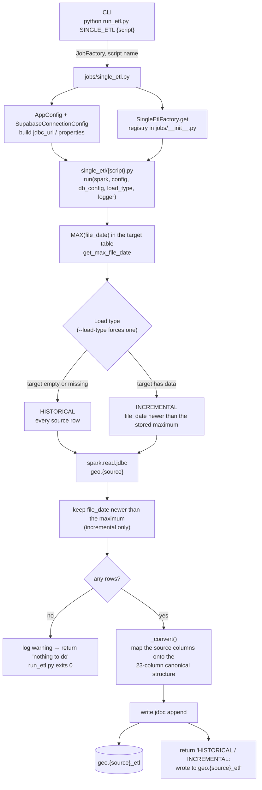

← [ETL jobs](../etl-jobs.md)

# SINGLE_ETL job

`jobs/single_etl.py` runs **one standalone PySpark script** from `single_etl/` — a complete read → transform → write pipeline for a single dataset, independent of the CREATE/INGESTION table pairs:



How the data flows:

1. `run_etl.py` resolves `JobType.SINGLE_ETL` → `jobs/single_etl.py` and passes the second positional argument as the **script name** — the file stem of a module in `single_etl/` (e.g. `avalanche_org_etl`).
2. `SingleEtlFactory` (`factory/single_etl_factory.py`) looks that name up in its registry; scripts are registered by `jobs/__init__.py`.
3. The job loads both configs and calls the script's `run(spark, config, db_config, load_type=..., logger=...)`.
4. The script resolves its [load type](load-types.md), reads its source table, applies its own `_convert()` transformation and appends the result to its target table.

```bash
python run_etl.py SINGLE_ETL avalanche_org_etl                    # auto load type
python run_etl.py SINGLE_ETL avalanche_org_etl --load-type historical
python run_etl.py SINGLE_ETL avalanche_org_etl --load-type incremental
```

`--load-type` accepts `auto` (default), `historical` or `incremental` and is rejected on any other job; the logs go to `logs/single_etl/single_etl_<script>_<timestamp>.log`. A run that finds nothing new warns and still exits `0` — the DATA_QUALITY behaviour, not the INGESTION one.

## avalanche_org_etl

`single_etl/avalanche_org_etl.py` is the reference script: `geo.avalanche_org` (one row per forecast zone per day) → `geo.avalanche_org_etl` (the 23-column structure from `model/etl/event_etl.py`).

| Target column | Source |
|---------------|--------|
| `subsource_name` | `center_name` (issuing center) |
| `place_location` | `zone_name`; `event_name` stays `NULL` — a forecast has no event name |
| `latitude` / `longitude` | polygon centroid of the zone from `cache/avalanche_zone_centroids.csv`, keyed `place_location` + `state_province` |
| `metric_name` | always `magnitude`; `metric_value` / `metric_unit` stay `NULL` — a danger level is a rating, not a measurement |
| `danger_rating` | zone rating as text, `NULL` while unrated (`danger_level = -1`, `danger_rating = "no rating"`) |
| `statement` | `travel_advice`, with `warning` appended when present |
| `event_start_date` | `date` (the forecast's calendar day) |
| `event_start` / `event_end` | `forecast_start` / `forecast_end` |
| `other_metrics` | `NULL` (zone ids and links are not metrics) |

When `cache/avalanche_zone_centroids.csv` is missing, the ETL builds it itself through `utils/fetch_avalanche_zones.py` — fetching today plus 10 and 30 days back, so zones that have left the avalanche.org feed stay covered — and only fails when that build fails (no network). To refresh the lookup or to pick the days yourself, run `python -m utils.fetch_avalanche_zones --day <day> [--day <day> …]` and rerun it whenever a zone is added or renamed. The CSV is parsed on the driver and embedded as literal columns, because the Spark containers only mount `GEO_Download/data`.

## eonet_event_etl

`single_etl/eonet_event_etl.py`: `geo.eonet_event` (NASA EONET hazard events) → `geo.eonet_event_etl` (the 23-column structure from `model/etl/event_etl.py`).

| Target column | Source |
|---------------|--------|
| `subsource_name` | `source_id` (reporting feed: `IRWIN`, `JTWC`, `NATICE`, `NOAA_NHC`, `EO`, `BYU_ICE`) |
| `event_name` | `event_name` |
| `event_category` | `category_id` → `storm` (`severeStorms`), `fire` (`wildfires`), `iceberg` (`seaLakeIce`); unknown ids are snake-cased (`volcanicAsh` → `volcanic_ash`) |
| `event_subcategory` | storm type parsed from `event_name` (`hurricane`, `typhoon`, `tropical storm`, `tropical cyclone`, `cyclone`); `wildfire` for fires; `sea_lake_ice` for ice; `NULL` when no keyword applies |
| `event_description` | `description`, `NULL` when blank |
| `latitude` / `longitude` | `latitude` / `longitude` — the event's own position |
| `country_code` / `state_province` | the US state at the end of `description` (fires: `… from Miles City, MT`), else the reverse-geocoded coordinate from `cache/reverse_geocode.csv`, else `ZZ` / `NULL` (open water) |
| `place_location` | `event_name` minus its type prefix (`Wildfire`, `Prescribed Fire`, `Incident Complex`, `Emergency Stabilization BAER`) when a place is left, e.g. `Wildfire Snow, Custer, Montana` → `Snow, Custer, Montana`; `NULL` for `Hurricane Polo` / `Iceberg D32` |
| `metric_name` | `wind speed` (storms), `area` (fires), `surface` (ice), `magnitude` for any other category |
| `metric_value` / `metric_unit` | `magnitude_value` / `magnitude_unit` |
| `danger_rating` / `statement` | `NULL` — EONET carries neither |
| `other_metrics` | `{"geometry_count": n}` — the event's geometry points |
| `event_start_date` / `event_start` | `event_date` |
| `event_end` | `last_date` |
| `last_latitude` / `last_longitude` | `last_latitude` / `last_longitude` — the latest position |
| `file_date` | `file_date` |

Coordinates missing from `cache/reverse_geocode.csv` are reverse-geocoded on the driver through `utils/reverse_geocode.py` (Nominatim / OpenStreetMap, keyless, paced to one request per second) the first time they appear: successful answers are written back to the cache and reused by every later run, while a failed fetch stops the run before anything is written. The CSV is read on the driver and embedded as literal columns, because the Spark containers only mount `GEO_Download/data`. The API answers open water with an empty country (the `ZZ` fallback).

## gdacs_event_etl

`single_etl/gdacs_event_etl.py`: `geo.gdacs_event` (GDACS disaster events, one row per event snapshot per `file_date`) → `geo.gdacs_event_etl` (the 23-column structure from `model/etl/event_etl.py`).

| Target column | Source |
|---------------|--------|
| `subsource_name` | `source` (contributing body: `NEIC`, `NOAA`, `JTWC`, `GWIS`, `GLOFAS`, `GDO`, VAAC and seismic network names) |
| `event_name` | `event_name` |
| `event_category` | `event_type` → `earthquake` (`EQ`), `storm` (`TC`), `flood` (`FL`), `volcano` (`VO`), `fire` (`WF`), `drought` (`DR`); unknown codes are lowercased (`XX` → `xx`) |
| `event_subcategory` | cyclone intensity class from `severity_text` (`tropical depression`, `tropical storm`, `hurricane` — GDACS's `Hurricane/Typhoon` counts as `hurricane`, matching the EONET keyword); `wildfire` for fires; `agricultural drought` for droughts; `NULL` when no subtype applies |
| `event_description` | `NULL` — GDACS carries no event description |
| `latitude` / `longitude` | `latitude` / `longitude` — epicentre (EQ) or affected-area centroid (the rest) |
| `country_code` | the source's ISO 3166-1 alpha-3 `country_code` translated to alpha-2 (`COUNTRY_CODE_MAP`: `USA` → `US`, `DEU` → `DE`, …), else the reverse-geocoded coordinate from `cache/reverse_geocode.csv`, else `ZZ` |
| `state_province` | the reverse-geocoded subdivision (GDACS has none), `NULL` when unknown |
| `place_location` | `country` — region at the centroid or affected-country list (e.g. `Brazil, Colombia`), `NULL` when blank |
| `metric_name` | `magnitude` (EQ/FL/VO), `wind speed` (TC), `area` (WF/DR) |
| `metric_value` | `severity`, with `0` ("not defined" — every FL and VO row) mapped to `NULL` |
| `metric_unit` | `severity_unit` (`M`, `km/h`, `ha`, `km2`), `NULL` when blank |
| `danger_rating` | `alert_level` (`Green` / `Orange` / `Red`) |
| `statement` | `severity_text` (impact/advisory sentence, e.g. `Magnitude 4.5M, Depth:10km`) |
| `other_metrics` / `last_latitude` / `last_longitude` | `NULL` — a snapshot has no metrics beyond the measurement and no track |
| `event_start_date` / `event_start` | `from_date` |
| `event_end` | `to_date` (= `from_date` for the instantaneous earthquakes) |
| `file_date` | `file_date` |

The source's alpha-3 country code wins because GDACS knows the affected country better than a centroid lookup; blank and unknown codes fall through to the same `cache/reverse_geocode.csv` lookup the EONET ETL uses — and since GDACS has no subdivision at all, **every** distinct coordinate of the run is reverse-geocoded on the driver through `utils/reverse_geocode.py` to fill `state_province` (a one-time cost per coordinate, kept in the shared cache). The CSV is read on the driver and embedded as literal columns, because the Spark containers only mount `GEO_Download/data`.

## ibtracs_cyclone_etl

`single_etl/ibtracs_cyclone_etl.py`: `geo.ibtracs_cyclone` (IBTrACS best track, one row per storm position per `file_date`) → `geo.ibtracs_cyclone_etl` (the 23-column structure from `model/etl/event_etl.py`).

| Target column | Source |
|---------------|--------|
| `subsource_name` | `basin` — the storm's basin (`NA`, `EP`, `WP`, `NI`), `NULL` when blank |
| `event_name` | `name` (e.g. `EDOUARD`; the source writes `UNNAMED` for unnamed systems), `NULL` when blank |
| `event_category` | always `storm` |
| `event_subcategory` | the ATCF system status `usa_status` (`hurricane`, `typhoon`, `tropical storm`, `tropical depression`, `disturbance`, `low`, …), falling back to the cross-agency `nature` (`tropical`, `disturbance`, `extratropical`, `subtropical`, `contradictory`) when no US agency reported a status; `NULL` when neither states a type (`nature = NR` in non-US basins) |
| `event_description` / `statement` | `NULL` — a best track carries no advisory prose |
| `latitude` / `longitude` | `lat` / `lon` — the position itself |
| `country_code` / `state_province` | the reverse-geocoded position of every point within 100 km of land (`cache/reverse_geocode.csv`), else `ZZ` / `NULL` (open water) — the source carries no country at all |
| `place_location` | full basin name extended with the sub-basin (`North Atlantic - Gulf of Mexico`, `Eastern North Pacific - Central Pacific`, `North Indian - Bay of Bengal`, …); just the basin name for the unnamed sub-basins (`NA`, `MM`) |
| `metric_name` | always `wind speed` |
| `metric_value` | `coalesce(wmo_wind, usa_wind)` — WMO values are absent in real-time data, so the US agency's knots win today |
| `metric_unit` | always `kts` |
| `danger_rating` | the Saffir-Simpson label of `usa_sshs` (`category 5` … `category 1`, `tropical storm`, `tropical depression`, `disturbance`, `subtropical`, `post-tropical`, `unknown`) |
| `other_metrics` | `{"pressure": …, "pressure_unit": "mb", "speed": …, "speed_unit": "kts", "direction": …, "direction_unit": "degrees", "gust": …, "gust_unit": "kts", "dist2land": …, "dist2land_unit": "km", "landfall": …, "landfall_unit": "km"}` — `usa_pres`, `storm_speed`, `storm_dir`, `usa_gust`, `dist2land` / `landfall`; every measurement is paired with its `<name>_unit` companion key, and one the position does not report is omitted together with its unit; `NULL` when it reports none |
| `event_start_date` / `event_start` / `event_end` | `date(iso_time)` / `iso_time` — one row = one track position |
| `last_latitude` / `last_longitude` | `lat` / `lon` of the maximum `iso_time` per `sid` — the storm's latest position |
| `file_date` | `file_date` |

The source knows no country, so geocoding is scoped to the points where it can answer: only positions with `dist2land ≤ 100 km` are looked up (open ocean resolves to `ZZ` anyway; a one-time cost per coordinate, kept in the shared cache), while already-cached answers of any other point are still embedded. `last_*` is a window maximum over `iso_time` per `sid`, which stays correct under `INCREMENTAL`: the newest points always arrive in the newest `file_date`, and storms that stopped reporting keep their previous `last_*` values.

## nifc_fire_etl

`single_etl/nifc_fire_etl.py`: `geo.nifc_fire` (NIFC/WFIGS fire perimeters, one row per perimeter per `file_date`) → `geo.nifc_fire_etl` (the 23-column structure from `model/etl/event_etl.py`).

| Target column | Source |
|---------------|--------|
| `subsource_name` | always `WFIGS` (the Wildland Fire Interagency Geospatial Services layer the perimeters come from) |
| `event_name` | `incident_name`, `NULL` when blank |
| `event_category` | always `fire` |
| `event_subcategory` | `fire_type`: `WF` → `wildfire`, `RX` → `prescribed fire`; `NULL` when the source states no type |
| `event_description` / `statement` / `danger_rating` | `NULL` — the perimeter layer carries no advisory prose or alert level |
| `latitude` / `longitude` | the feature centroid of the perimeter |
| `country_code` | always `US` — the layer only publishes US perimeters |
| `state_province` | `state` when present (the 2026-09-18 vintage on), else the reverse-geocoded centroid (`cache/reverse_geocode.csv`), `NULL` when neither resolves |
| `place_location` | the full name of `jurisdiction_label` resolved through `cache/nifc_unit_names.csv` (`WAOWF` → `Okanogan-Wenatchee National Forest`, `CAYNP` → `Yosemite National Park`, `TXTXS` → `Texas A & M Forest Service`, …); a code the lookup does not know keeps its raw value, a blank one is `NULL` — the agency codes in `jurisdiction` have no published domain and are not used |
| `metric_name` | always `area` |
| `metric_value` | `acres`, counting a missing acreage as `0` (the pre-2026-09-18 vintage predates the field) |
| `metric_unit` | always `acres` |
| `other_metrics` | `{"percent_contained": …, "percent_contained_unit": "%"}` — always present: a missing `percent_contained` counts as `0` (nothing reported yet), so both keys stay valid |
| `event_start_date` / `event_start` | `date(created_on)` / `created_on` |
| `event_end` | `NULL` — the layer carries no fire-out datetime |
| `last_latitude` / `last_longitude` | `NULL` — the layer carries no latest position |
| `file_date` | `file_date` |

Both lookups run on the driver and are embedded as literal map columns (the Spark containers only mount `GEO_Download/data`): the unit names come from `utils/fetch_nifc_units.py`, which builds `cache/nifc_unit_names.csv` when it is missing and refreshes it automatically when the data carries a code the file does not know — one request per new code. The reverse geocoding answers only the rows with a blank `state` (the pre-state vintage, ~127 coordinates today), the source's own subdivision always wins.

## openmeteo_flood_etl

`single_etl/openmeteo_flood_etl.py`: `geo.openmeteo_flood` (Open-Meteo/GloFAS river discharge, one row per river per `date` per `file_date`) → `geo.openmeteo_flood_etl` (the 23-column structure from `model/etl/event_etl.py`).

| Target column | Source |
|---------------|--------|
| `source_name` | always `OPENMETEO` |
| `subsource_name` | always `GLOFAS` (the Copernicus GloFAS model the discharge is simulated with) |
| `event_name` | `"<river_name> discharge"` (`Amazon discharge`), `NULL` when the river name is blank |
| `event_category` | always `flood` |
| `event_subcategory` / `event_description` / `statement` / `danger_rating` | `NULL` — the daily value carries no subtype, prose or alert level |
| `latitude` / `longitude` | the `rivers.json` reference point of the river (stable per river; the GloFAS cell actually used is the nearest 0.05°/~5 km grid cell) |
| `country_code` | the source `country` name mapped through the script's 54-entry ISO map (`USA` → `US`, `UK` → `GB`, `DRC` → `CD`); an unknown name falls back to the reverse-geocoded reference point, an empty geocode resolves to `ZZ` |
| `state_province` | the reverse-geocoded reference point (`cache/reverse_geocode.csv`), `NULL` when the API found no subdivision |
| `place_location` | `"<river_name> - <country>"` (`Amazon - Brazil`); a blank part is dropped, both blank is `NULL` |
| `metric_name` | always `discharge` |
| `metric_value` | `discharge_m3s` — the GloFAS 24-h mean in m³/s, counting a missing value as `0` (the source skips null-discharge days, so none occur) |
| `metric_unit` | always `m³/s` |
| `event_start_date` / `event_start` | `date` at midnight / `date` itself — the GMT+0 day of the 24-h mean |
| `event_end` | `NULL` — a daily value has no end |
| `last_latitude` / `last_longitude` | `NULL` — the reference point is fixed, there is no latest position |
| `other_metrics` | `NULL` — the daily mean is the single measurement (the lead time `date - file_date` is derivable) |
| `file_date` | `file_date` |

Each downloaded file holds the analysis day plus the next day's forecast (222 rows = 111 rivers × 2 days), so a `(river, date)` pair appears in two files — yesterday's forecast is today's analysis — and the ETL keeps every snapshot as its own row; `(river, date, file_date)` is unique, so no deduplication is needed. The country map and both geocode lookups run on the driver and are embedded as literal map columns (the Spark containers only mount `GEO_Download/data`); every distinct reference point of the plain table is reverse-geocoded once into the shared `cache/reverse_geocode.csv` (~111 coordinates) and reused by every later run.

## Adding a new script

1. Copy `single_etl/avalanche_org_etl.py` to `single_etl/<name>_etl.py` and rewrite `SOURCE_TABLE`, `TARGET_TABLE` and `_convert()` for the new source (the module docstring walks through it).
2. Register it in `jobs/__init__.py`:

```python
from single_etl.<name>_etl import run as <name>_etl_run

SingleEtlFactory.register("<name>_etl", <name>_etl_run)
```

3. Run it: `python run_etl.py SINGLE_ETL <name>_etl`.

