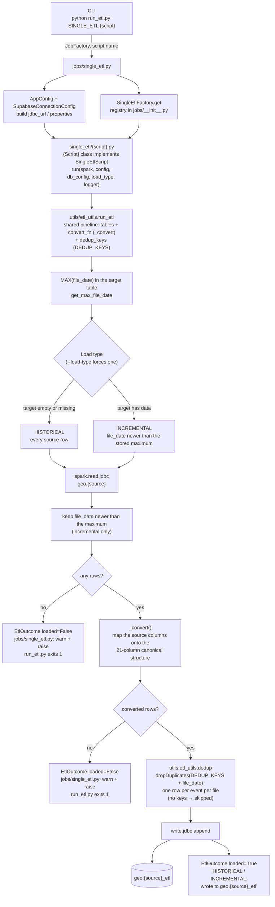

← [ETL jobs](../etl-jobs.md)

# SINGLE_ETL job

`jobs/single_etl.py` runs **one standalone PySpark script** from `single_etl/` — a complete read → transform → deduplicate → write pipeline for a single dataset, independent of the CREATE/INGESTION table pairs. Each script is a `SingleEtlScript` subclass (`single_etl/single_etl_script.py`) whose `run()` method delegates to the shared runner `utils/etl_utils.run_etl()`, fed the class's tables, its `_convert()` handler and its `DEDUP_KEYS` (loaded from the script's `config.json` entry):



How the data flows:

1. `run_etl.py` resolves `JobType.SINGLE_ETL` → `jobs/single_etl.py` and passes the second positional argument as the **script name** — the file stem of a module in `single_etl/` (e.g. `avalanche_org_etl`).
2. `SingleEtlFactory` (`factory/single_etl_factory.py`) looks that name up in its registry; scripts are registered by `jobs/__init__.py`.
3. The job loads both configs, looks the script up in the registry and calls its `run(spark, config, db_config, load_type=..., logger=...)` — the `SingleEtlScript` interface method, which delegates to `utils/etl_utils.run_etl()` with the class's `SOURCE_TABLE`, `TARGET_TABLE`, `_convert()` and `DEDUP_KEYS` — all sourced from `config.json`.
4. The runner resolves the [load type](load-types.md) from the state of the target table, reads the source table — or several tables, stacked with `unionByName` first, as the [`union_etl` script](single-etl/union-etl.md) does — applies the script's `_convert()` transformation, deduplicates the result per [`DEDUP_KEYS` + `file_date`](#deduplication) and appends it to the target table, returning an `EtlOutcome` (`loaded` + `summary`).
5. The **job** decides the exit status: `loaded=True` → completion message; `loaded=False` (nothing newer than the target's max, empty source, or `_convert` produced no rows) → it warns with the outcome's summary and raises `RuntimeError`, so `run_etl.py` exits with code 1.

```bash
python run_etl.py SINGLE_ETL <table_name>_etl                    # auto load type
python run_etl.py SINGLE_ETL <table_name>_etl --load-type historical
python run_etl.py SINGLE_ETL <table_name>_etl --load-type incremental
```

`--load-type` accepts `auto` (default), `historical` or `incremental` and is rejected on any other job; the logs go to `logs/single_etl/single_etl_<script>_<timestamp>.log`. A run that loads no records makes the **job** warn and **raise**, so `run_etl.py` exits with code 1 — the INGESTION behaviour (`DATA_QUALITY` is the job that still finishes green on an unchanged table):

```
WARNING No records loaded into avalanche_org_etl — no rows to process in avalanche_org
ERROR ETL job failed   (RuntimeError)   → exit code 1
```

## Deduplication

After `_convert()` maps a source onto the 21-column structure, the shared runner passes the frame through `utils/etl_utils.dedup()` — `dropDuplicates(DEDUP_KEYS + file_date)`. `DEDUP_KEYS` is the script's `datasets.single_etl.<script>.dedup_keys` from `config.json`; `SingleEtlDatasetConfig` rejects an empty, duplicate or `file_date` key set when the script is imported.

**Duplication predicate.** For a script with key set `K = DEDUP_KEYS`, two converted rows `r1`, `r2` **of the batch being written** are duplicates **iff**

```
r1.file_date = r2.file_date   AND   for every k in K: r1.k == r2.k
```

where `==` is Spark's exact, null-safe column equality:

- **exact** — values must match as stored: timestamps to full precision, coordinates with no rounding or distance tolerance; no normalisation, case-folding or fuzzy matching of any kind;
- **null-safe** — `NULL == NULL`: two rows whose key column is `NULL` (avalanche forecasts have `event_name = NULL`, a standing product can have no forecast window) match on that column exactly like any other value;
- **key-only** — payload columns (`metric_value`, `danger_rating`, `other_metrics`, `event_end` where it is not a key, …) do not participate in the match: rows agreeing on every key are duplicates even when their payloads differ;
- **scoped per file** — the first conjunct confines each group to a single `file_date`, so a snapshot stored under another `file_date` can never join a group and the event's per-day history survives (this is exactly the scope `DATA_QUALITY` measures at).

Every group collapses to **one row**. `dropDuplicates` guarantees no particular survivor when the members differ in payload (the only conflict observed in production is avalanche.org's standing product carrying `off_season` as both `true` and `false`); the run's log line reports how many rows the step removed.

The step only ever sees the current batch — `HISTORICAL` reads the whole table, `INCREMENTAL` only the files newer than the target's maximum — and because each file passes through this step on its first load, no duplicates per `file_date` exist table-wide afterwards. A forced `--load-type historical` reprocess *appends* on top of existing rows, so the target must be cleared first (that is what the rebuild procedure and every reload do); otherwise the re-listed files would duplicate the stored ones, which batch-scoped deduplication cannot see. [`union_etl`](single-etl/union-etl.md) declares no keys (`K = ∅`): it stacks sources that are already deduplicated by their own scripts, so the runner skips the step.

Each run logs what it removed: `Deduplication on (event_category, event_name, latitude, longitude, event_start, file_date) removed 288 of 10818 rows`.

> **Not the same predicate as `dup_row_pct`.**

Some `_convert()` planners are shared across several source scripts so a duplicate implementation cannot drift apart: 

- `utils.column_helpers.literal_map(mapping)` builds a Spark literal map column from any config mapping, which is exactly what a `F.create_map(*[F.lit(item) for pair in mapping.items() for item in pair])` call site used to spell out inline — used to look up a value by key in each script's category, country, danger-rating, label, qualifier, status, nature, basin, sub-basin and SSHS mappings (one script keeps a **different** pattern that builds its map from a derived `pairs` list and is not using the helper yet);
- `utils.column_helpers.state_province(geocode_state)` returns the stamped `geocode_state` of a point as an uppercase ISO 3166-2 / subdivision code, or `NULL` when the stamp is blank — used by **four** source scripts (`gdacs_event_etl`, `ibtracs_cyclone_etl`, `usgs_nwis_etl`, `openmeteo_flood_etl`); the other six scripts each keep their own variant because their logic differs (earthquake uppercases the `net` column, nifc prefers the source's own `state` over the stamp, eonet splits the `description` state from the stamp, volcano returns `ZZ` instead of `NULL` for an empty stamp).

Neither helper calls any external service — both are pure Spark expressions. The DATA_QUALITY metric [`dup_row_pct`](../data-quality-metrics.md) tests full-row equality over **all 21 columns**; this step matches only `K + file_date`. Full-row equality implies key equality (the key columns are a subset of the row), so once this step has run, `dup_row_pct` is necessarily `0` for every `file_date` — and the step is strictly stronger, since it also collapses rows that differ in payload.

**Key sets per script** — `K` as configured in `config.json` (`datasets.single_etl.<script>.dedup_keys`) and exposed as the class's `DEDUP_KEYS`; `file_date` is added by the runner and never belongs to `K` itself:

| Script | `DEDUP_KEYS` (= K) | One row per… |
|--------|--------------|--------------|
| [`avalanche_org_etl`](single-etl/avalanche-org.md) | `subsource_name`, `state_province`, `place_location`, `latitude`, `longitude`, `event_start`, `event_end` | forecast statement (zone × window) — collapses the `[D, D+1]` copies of the off-season product and the conflicting `off_season` rows |
| [`eonet_event_etl`](single-etl/eonet-event.md) | `event_name`, `latitude`, `longitude`, `event_start` | event geometry |
| [`gdacs_event_etl`](single-etl/gdacs-event.md) | `event_category`, `event_name`, `latitude`, `longitude`, `event_start` | event snapshot — GDACS paginates its lists, so one file can carry the same event twice |
| [`ibtracs_cyclone_etl`](single-etl/ibtracs-cyclone.md) | `subsource_name`, `event_name`, `latitude`, `longitude`, `event_start` | track position |
| [`nifc_fire_etl`](single-etl/nifc-fire.md) | `event_name`, `latitude`, `longitude`, `event_start` | perimeter snapshot |
| [`openmeteo_flood_etl`](single-etl/openmeteo-flood.md) | `event_name`, `place_location`, `latitude`, `longitude`, `event_start` | river-day |
| [`usgs_earthquake_etl`](single-etl/usgs-earthquake.md) | `event_start`, `latitude`, `longitude` | seismic event (epicentre + origin time) |
| [`usgs_nwis_etl`](single-etl/usgs-nwis.md) | `subsource_name`, `event_start` | gauge-day |
| [`usgs_volcano_etl`](single-etl/usgs-volcano.md) | `event_name`, `event_start`, `subsource_name` | notice (volcano × issue time × observatory) |
| [`union_etl`](single-etl/union-etl.md) | *(none)* | the stacked `*_etl` rows, already deduplicated by their scripts |

## Source scripts

Each script maps one source table onto the canonical 21-column structure. The per-source
column mappings and source-specific notes live on their own pages:

| Script | Source → target | Page |
|--------|-----------------|------|
| `avalanche_org_etl` | `geo.avalanche_org` → `geo.avalanche_org_etl` | [avalanche_org_etl](single-etl/avalanche-org.md) |
| `eonet_event_etl` | `geo.eonet_event` → `geo.eonet_event_etl` | [eonet_event_etl](single-etl/eonet-event.md) |
| `gdacs_event_etl` | `geo.gdacs_event` → `geo.gdacs_event_etl` | [gdacs_event_etl](single-etl/gdacs-event.md) |
| `ibtracs_cyclone_etl` | `geo.ibtracs_cyclone` → `geo.ibtracs_cyclone_etl` | [ibtracs_cyclone_etl](single-etl/ibtracs-cyclone.md) |
| `nifc_fire_etl` | `geo.nifc_fire` → `geo.nifc_fire_etl` | [nifc_fire_etl](single-etl/nifc-fire.md) |
| `openmeteo_flood_etl` | `geo.openmeteo_flood` → `geo.openmeteo_flood_etl` | [openmeteo_flood_etl](single-etl/openmeteo-flood.md) |
| `usgs_earthquake_etl` | `geo.usgs_earthquake` → `geo.usgs_earthquake_etl` | [usgs_earthquake_etl](single-etl/usgs-earthquake.md) |
| `usgs_nwis_etl` | `geo.usgs_nwis` → `geo.usgs_nwis_etl` | [usgs_nwis_etl](single-etl/usgs-nwis.md) |
| `usgs_volcano_etl` | `geo.usgs_volcano` → `geo.usgs_volcano_etl` | [usgs_volcano_etl](single-etl/usgs-volcano.md) |
| `union_etl` | every `*_etl` table → `geo.union_etl` | [union_etl](single-etl/union-etl.md) |

The [deduplication table](#deduplication) above lists each script's `DEDUP_KEYS`; the
[union_etl page](single-etl/union-etl.md) covers the per-source incremental filter.

## Adding a new script

1. Add a `datasets.single_etl.<name>_etl` entry to `config.json` (source and ETL table names, `source_name`, `dedup_keys`, plus any category/country maps, metric labels or lookup tables the source needs) and a `<Name>EtlConfig` model for it in `model/config/datasets.py`.
2. Copy `single_etl/avalanche_org_etl.py` to `single_etl/<name>_etl.py`, rename the class to `<Name>EtlScript`, point `load_dataset()` at the new config class and rewrite the `_convert()` method for the new source (the module docstring walks through it) — `run()` is inherited from `SingleEtlScript` and needs no change, it delegates to `utils/etl_utils.run_etl()` for every source. Set the source's `dedup_keys` in the config entry (the [deduplication table](#deduplication) above shows what each existing script uses): the canonical columns that identify one natural event, without `file_date`. The model validates the list and the class derives `DEDUP_KEYS` from it.
3. Register an instance in `jobs/__init__.py`:

```python
from single_etl.<name>_etl import <Name>EtlScript

_script = <Name>EtlScript()
SingleEtlFactory.register(_script.TARGET_TABLE, _script)
```

4. Run it: `python run_etl.py SINGLE_ETL <name>_etl`.

