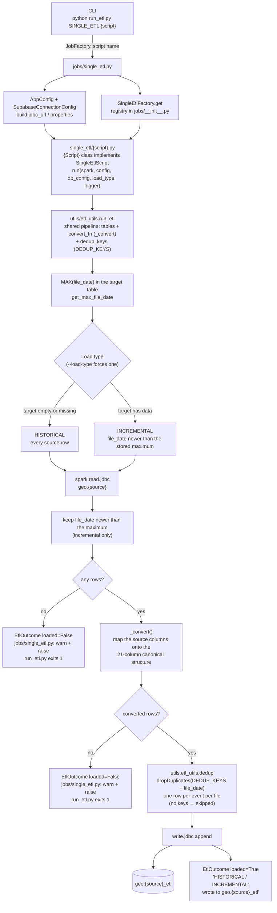

← [ETL jobs](../etl-jobs.md)

# SINGLE_ETL job

`jobs/single_etl.py` runs **one standalone PySpark script** from `single_etl/` — a complete read → transform → deduplicate → write pipeline for a single dataset, independent of the CREATE/INGESTION table pairs. Each script is a `SingleEtlScript` subclass (`single_etl/single_etl_script.py`) whose `run()` method delegates to the shared runner `utils/etl_utils.run_etl()`, fed the class's tables, its `_convert()` handler and its `DEDUP_KEYS`:



How the data flows:

1. `run_etl.py` resolves `JobType.SINGLE_ETL` → `jobs/single_etl.py` and passes the second positional argument as the **script name** — the file stem of a module in `single_etl/` (e.g. `avalanche_org_etl`).
2. `SingleEtlFactory` (`factory/single_etl_factory.py`) looks that name up in its registry; scripts are registered by `jobs/__init__.py`.
3. The job loads both configs, looks the script up in the registry and calls its `run(spark, config, db_config, load_type=..., logger=...)` — the `SingleEtlScript` interface method, which delegates to `utils/etl_utils.run_etl()` with the class's `SOURCE_TABLE`, `TARGET_TABLE`, `_convert()` and `DEDUP_KEYS`.
4. The runner resolves the [load type](load-types.md) from the state of the target table, reads the source table — or several tables, stacked with `unionByName` first, as the [`union_etl` script](#union_etl) does — applies the script's `_convert()` transformation, deduplicates the result per [`DEDUP_KEYS` + `file_date`](#deduplication) and appends it to the target table, returning an `EtlOutcome` (`loaded` + `summary`).
5. The **job** decides the exit status: `loaded=True` → completion message; `loaded=False` (nothing newer than the target's max, empty source, or `_convert` produced no rows) → it warns with the outcome's summary and raises `RuntimeError`, so `run_etl.py` exits with code 1.

```bash
python run_etl.py SINGLE_ETL <table_name>_etl                    # auto load type
python run_etl.py SINGLE_ETL <table_name>_etl --load-type historical
python run_etl.py SINGLE_ETL <table_name>_etl --load-type incremental
```

`--load-type` accepts `auto` (default), `historical` or `incremental` and is rejected on any other job; the logs go to `logs/single_etl/single_etl_<script>_<timestamp>.log`. A run that loads no records makes the **job** warn and **raise**, so `run_etl.py` exits with code 1 — the INGESTION behaviour (`DATA_QUALITY` is the job that still finishes green on an unchanged table):

```
WARNING No records loaded into avalanche_org_etl — no rows to process in avalanche_org
ERROR ETL job failed   (RuntimeError)   → exit code 1
```

## Deduplication

After `_convert()` maps a source onto the 21-column structure, the shared runner passes the frame through `utils/etl_utils.dedup()` — `dropDuplicates(DEDUP_KEYS + file_date)`.

**Duplication predicate.** For a script with key set `K = DEDUP_KEYS`, two converted rows `r1`, `r2` **of the batch being written** are duplicates **iff**

```
r1.file_date = r2.file_date   AND   for every k in K: r1.k == r2.k
```

where `==` is Spark's exact, null-safe column equality:

- **exact** — values must match as stored: timestamps to full precision, coordinates with no rounding or distance tolerance; no normalisation, case-folding or fuzzy matching of any kind;
- **null-safe** — `NULL == NULL`: two rows whose key column is `NULL` (avalanche forecasts have `event_name = NULL`, a standing product can have no forecast window) match on that column exactly like any other value;
- **key-only** — payload columns (`metric_value`, `danger_rating`, `other_metrics`, `event_end` where it is not a key, …) do not participate in the match: rows agreeing on every key are duplicates even when their payloads differ;
- **scoped per file** — the first conjunct confines each group to a single `file_date`, so a snapshot stored under another `file_date` can never join a group and the event's per-day history survives (this is exactly the scope `DATA_QUALITY` measures at).

Every group collapses to **one row**. `dropDuplicates` guarantees no particular survivor when the members differ in payload (the only conflict observed in production is avalanche.org's standing product carrying `off_season` as both `true` and `false`); the run's log line reports how many rows the step removed.

The step only ever sees the current batch — `HISTORICAL` reads the whole table, `INCREMENTAL` only the files newer than the target's maximum — and because each file passes through this step on its first load, no duplicates per `file_date` exist table-wide afterwards. A forced `--load-type historical` reprocess *appends* on top of existing rows, so the target must be cleared first (that is what the rebuild procedure and every reload do); otherwise the re-listed files would duplicate the stored ones, which batch-scoped deduplication cannot see. `union_etl` declares no keys (`K = ∅`): it stacks sources that are already deduplicated by their own scripts, so the runner skips the step.

Each run logs what it removed: `Deduplication on (event_category, event_name, latitude, longitude, event_start, file_date) removed 288 of 10818 rows`.

> **Not the same predicate as `dup_row_pct`.** The DATA_QUALITY metric [`dup_row_pct`](../data-quality-metrics.md) tests full-row equality over **all 21 columns**; this step matches only `K + file_date`. Full-row equality implies key equality (the key columns are a subset of the row), so once this step has run, `dup_row_pct` is necessarily `0` for every `file_date` — and the step is strictly stronger, since it also collapses rows that differ in payload.

**Key sets per script** — `K` as declared in the class's `DEDUP_KEYS`; `file_date` is added by the runner and never belongs to `K` itself:

| Script | `DEDUP_KEYS` (= K) | One row per… |
|--------|--------------|--------------|
| `avalanche_org_etl` | `subsource_name`, `state_province`, `place_location`, `latitude`, `longitude`, `event_start`, `event_end` | forecast statement (zone × window) — collapses the `[D, D+1]` copies of the off-season product and the conflicting `off_season` rows |
| `eonet_event_etl` | `event_name`, `latitude`, `longitude`, `event_start` | event geometry |
| `gdacs_event_etl` | `event_category`, `event_name`, `latitude`, `longitude`, `event_start` | event snapshot — GDACS paginates its lists, so one file can carry the same event twice |
| `ibtracs_cyclone_etl` | `subsource_name`, `event_name`, `latitude`, `longitude`, `event_start` | track position |
| `nifc_fire_etl` | `event_name`, `latitude`, `longitude`, `event_start` | perimeter snapshot |
| `openmeteo_flood_etl` | `event_name`, `place_location`, `latitude`, `longitude`, `event_start` | river-day |
| `usgs_earthquake_etl` | `event_start`, `latitude`, `longitude` | seismic event (epicentre + origin time) |
| `usgs_nwis_etl` | `subsource_name`, `event_start` | gauge-day |
| `usgs_volcano_etl` | `event_name`, `event_start`, `subsource_name` | notice (volcano × issue time × observatory) |
| `union_etl` | *(none)* | the stacked `*_etl` rows, already deduplicated by their scripts |

## avalanche_org_etl

`single_etl/avalanche_org_etl.py` is the reference script: `geo.avalanche_org` (one row per forecast zone per day) → `geo.avalanche_org_etl` (the 21-column structure from `model/etl/event_etl.py`).

| Target column | Source |
|---------------|--------|
| `subsource_name` | `center_name` (issuing center) |
| `place_location` | `zone_name`; `event_name` stays `NULL` — a forecast has no event name |
| `latitude` / `longitude` | the source's `latitude` / `longitude` columns — polygon centroid of the zone computed by GEO_Download at download time |
| `metric_name` | always `magnitude`; `metric_value` / `metric_unit` stay `NULL` — a danger level is a rating, not a measurement |
| `danger_rating` | zone rating as text, `NULL` while unrated (`danger_level = -1`, `danger_rating = "no rating"`) |
| `event_start` / `event_end` | `forecast_start` / `forecast_end` |
| `other_metrics` | `{"danger_level": …, "danger_level_unit": "NAPADS level", "warning": "warning", "off_season": …}` — the raw scale index (`-1` = no rating) with its `<name>_unit` companion key, the avalanche-warning product (omitted while no warning covers the zone) and the season state; zone ids and links are not metrics |

The coordinates ship with every source row, so this ETL performs no lookup and needs no network: GEO_Download computes each zone's polygon centroid when the daily CSVs are written (and consolidates them in `GEO_Download/data/avalanche_org_notices.csv`). A row without coordinates (`latitude` / `longitude` empty — the download found no usable geometry) maps to `NULL`.

Each source file holds the analysis day plus the next day's forecast (the shared `[D, D+1]` download range), and `date` is not part of the canonical structure — while both rows share one forecast window (the off-season "no rating" product), they project to the same dedup key. The shared [deduplication step](#deduplication) (`DEDUP_KEYS` + `file_date`, applied after `_convert`) collapses such copies — and rows differing only in payload, e.g. a conflicting `off_season` flag — so the target keeps one row per forecast statement per `file_date` (one row per zone per file); rows that differ — e.g. the next day's own validity window in season — keep a different key and stay their own snapshot.

## eonet_event_etl

`single_etl/eonet_event_etl.py`: `geo.eonet_event` (NASA EONET hazard events) → `geo.eonet_event_etl` (the 21-column structure from `model/etl/event_etl.py`).

| Target column | Source |
|---------------|--------|
| `subsource_name` | `source_id` (reporting feed: `IRWIN`, `JTWC`, `NATICE`, `NOAA_NHC`, `EO`, `BYU_ICE`) |
| `event_name` | `event_name` |
| `event_category` | `category_id` → `storm` (`severeStorms`), `fire` (`wildfires`), `iceberg` (`seaLakeIce`); unknown ids are snake-cased (`volcanicAsh` → `volcanic_ash`) |
| `event_subcategory` | storm type parsed from `event_name` (`hurricane`, `typhoon`, `tropical storm`, `tropical cyclone`, `cyclone`); `wildfire` for fires; `sea_lake_ice` for ice; `NULL` when no keyword applies |
| `event_description` | `description`, `NULL` when blank |
| `latitude` / `longitude` | `latitude` / `longitude` — the event's own position |
| `country_code` / `state_province` | the US state at the end of `description` (fires: `… from Miles City, MT`), else the stamped `geocode_country` / `geocode_state` columns, else `ZZ` / `NULL` (open water) |
| `place_location` | `event_name` minus its type prefix (`Wildfire`, `Prescribed Fire`, `Incident Complex`, `Emergency Stabilization BAER`) when a place is left, e.g. `Wildfire Snow, Custer, Montana` → `Snow, Custer, Montana`; `NULL` for `Hurricane Polo` / `Iceberg D32` |
| `metric_name` | `wind speed` (storms), `area` (fires), `surface` (ice), `magnitude` for any other category |
| `metric_value` / `metric_unit` | `magnitude_value` / `magnitude_unit` |
| `danger_rating` | `NULL` — EONET carries no rating |
| `other_metrics` | `{"geometry_count": n}` — the event's geometry points |
| `event_start` | `event_date` |
| `event_end` | `last_date` |
| `last_latitude` / `last_longitude` | `last_latitude` / `last_longitude` — the latest position |
| `file_date` | `file_date` |

Both answers arrive with every row: GEO_Download stamps `geocode_country` / `geocode_state` into the daily CSVs at download time (its own cached Nominatim / OpenStreetMap lookup), and this ETL only reads the two plain-table columns and applies the precedence in the table — the description's US state first, the stamped answer second, `ZZ` / `NULL` when neither resolves (open water). GEO_ETL performs no lookup and no API call of its own.

## gdacs_event_etl

`single_etl/gdacs_event_etl.py`: `geo.gdacs_event` (GDACS disaster events, one row per event snapshot per `file_date`) → `geo.gdacs_event_etl` (the 21-column structure from `model/etl/event_etl.py`).

| Target column | Source |
|---------------|--------|
| `subsource_name` | `source` (contributing body: `NEIC`, `NOAA`, `JTWC`, `GWIS`, `GLOFAS`, `GDO`, VAAC and seismic network names) |
| `event_name` | `event_name` |
| `event_category` | `event_type` → `earthquake` (`EQ`), `storm` (`TC`), `flood` (`FL`), `volcano` (`VO`), `fire` (`WF`), `drought` (`DR`); unknown codes are lowercased (`XX` → `xx`) |
| `event_subcategory` | cyclone intensity class from `severity_text` (`tropical depression`, `tropical storm`, `hurricane` — GDACS's `Hurricane/Typhoon` counts as `hurricane`, matching the EONET keyword); `wildfire` for fires; `agricultural drought` for droughts; `NULL` when no subtype applies |
| `event_description` | `NULL` — GDACS carries no event description |
| `latitude` / `longitude` | `latitude` / `longitude` — epicentre (EQ) or affected-area centroid (the rest) |
| `country_code` | the source's ISO 3166-1 alpha-3 `country_code` translated to alpha-2 (`_cfg.country_code_map`: `USA` → `US`, `DEU` → `DE`, …), else the stamped `geocode_country` column, else `ZZ` |
| `state_province` | the stamped `geocode_state` column (GDACS has none), `NULL` when empty |
| `place_location` | `country` — region at the centroid or affected-country list (e.g. `Brazil, Colombia`), `NULL` when blank |
| `metric_name` | `magnitude` (EQ/FL/VO), `wind speed` (TC), `area` (WF/DR) |
| `metric_value` | `severity`, with `0` ("not defined" — every FL and VO row) mapped to `NULL` |
| `metric_unit` | `severity_unit` (`M`, `km/h`, `ha`, `km2`), `NULL` when blank |
| `danger_rating` | `alert_level` (`Green` / `Orange` / `Red`) |
| `other_metrics` / `last_latitude` / `last_longitude` | `NULL` — a snapshot has no metrics beyond the measurement and no track |
| `event_start` | `from_date` |
| `event_end` | `to_date` (= `from_date` for the instantaneous earthquakes) |
| `file_date` | `file_date` |

The source's alpha-3 country code wins because GDACS knows the affected country better than a centroid lookup; blank and unknown codes fall through to the stamped `geocode_country`, and `state_province` comes from the stamped `geocode_state` (GDACS carries no subdivision of its own). GEO_Download fills both columns for every distinct coordinate when the daily CSVs are written, so this ETL reads them off the plain table and applies only its maps and fallbacks — no lookup file, no API call, no driver-side map.

## ibtracs_cyclone_etl

`single_etl/ibtracs_cyclone_etl.py`: `geo.ibtracs_cyclone` (IBTrACS best track, one row per storm position per `file_date`) → `geo.ibtracs_cyclone_etl` (the 21-column structure from `model/etl/event_etl.py`).

| Target column | Source |
|---------------|--------|
| `subsource_name` | `basin` — the storm's basin (`NA`, `EP`, `WP`, `NI`), `NULL` when blank |
| `event_name` | `name` (e.g. `EDOUARD`; the source writes `UNNAMED` for unnamed systems), `NULL` when blank |
| `event_category` | always `storm` |
| `event_subcategory` | the ATCF system status `usa_status` (`hurricane`, `typhoon`, `tropical storm`, `tropical depression`, `disturbance`, `low`, …), falling back to the cross-agency `nature` (`tropical`, `disturbance`, `extratropical`, `subtropical`, `contradictory`) when no US agency reported a status; `NULL` when neither states a type (`nature = NR` in non-US basins) |
| `event_description` | `NULL` — a best track carries no advisory prose |
| `latitude` / `longitude` | `lat` / `lon` — the position itself |
| `country_code` / `state_province` | the stamped `geocode_country` / `geocode_state` columns, else `ZZ` / `NULL` (open water) — the source carries no country at all |
| `place_location` | full basin name extended with the sub-basin (`North Atlantic - Gulf of Mexico`, `Eastern North Pacific - Central Pacific`, `North Indian - Bay of Bengal`, …); just the basin name for the unnamed sub-basins (`NA`, `MM`) |
| `metric_name` | always `wind speed` |
| `metric_value` | `coalesce(wmo_wind, usa_wind)` — WMO values are absent in real-time data, so the US agency's knots win today |
| `metric_unit` | always `kts` |
| `danger_rating` | the Saffir-Simpson label of `usa_sshs` (`category 5` … `category 1`, `tropical storm`, `tropical depression`, `disturbance`, `subtropical`, `post-tropical`, `unknown`) |
| `other_metrics` | `{"pressure": …, "pressure_unit": "mb", "speed": …, "speed_unit": "kts", "direction": …, "direction_unit": "degrees", "gust": …, "gust_unit": "kts", "dist2land": …, "dist2land_unit": "km", "landfall": …, "landfall_unit": "km"}` — `usa_pres`, `storm_speed`, `storm_dir`, `usa_gust`, `dist2land` / `landfall`; every measurement is paired with its `<name>_unit` companion key, and one the position does not report is omitted together with its unit; `NULL` when it reports none |
| `event_start` / `event_end` | `iso_time` — one row = one track position |
| `last_latitude` / `last_longitude` | `lat` / `lon` of the maximum `iso_time` per `sid` — the storm's latest position |
| `file_date` | `file_date` |

The source knows no country, so GEO_Download answers it at download time: every row carries the stamped `geocode_country` / `geocode_state` columns (its fetch set is the positions within 100 km of land; far-ocean points keep an already-cached answer or stay empty), and this ETL only reads them, resolving an empty answer to `ZZ` / `NULL` (open water). `last_*` is a window maximum over `iso_time` per `sid`, which stays correct under `INCREMENTAL`: the newest points always arrive in the newest `file_date`, and storms that stopped reporting keep their previous `last_*` values.

## nifc_fire_etl

`single_etl/nifc_fire_etl.py`: `geo.nifc_fire` (NIFC/WFIGS fire perimeters, one row per perimeter per `file_date`) → `geo.nifc_fire_etl` (the 21-column structure from `model/etl/event_etl.py`).

| Target column | Source |
|---------------|--------|
| `subsource_name` | always `WFIGS` (the Wildland Fire Interagency Geospatial Services layer the perimeters come from) |
| `event_name` | `incident_name`, `NULL` when blank |
| `event_category` | always `fire` |
| `event_subcategory` | `fire_type`: `WF` → `wildfire`, `RX` → `prescribed fire`; `NULL` when the source states no type |
| `event_description` / `danger_rating` | `NULL` — the perimeter layer carries no advisory prose or alert level |
| `latitude` / `longitude` | the feature centroid of the perimeter |
| `country_code` | always `US` — the layer only publishes US perimeters |
| `state_province` | `state` when present (the 2026-09-18 vintage on), else the stamped `geocode_state` column, `NULL` when neither resolves |
| `place_location` | the full name as it ships with the source row in `unit_name` (GEO_Download resolves `jurisdiction_label` through its `data/nifc_unit_names.csv` lookup when the daily CSVs are written: `WAOWF` → `Okanogan-Wenatchee National Forest`, `CAYNP` → `Yosemite National Park`, `TXTXS` → `Texas A & M Forest Service`, …); a code the lookup does not know keeps its raw value, a blank one is `NULL` — the agency codes in `jurisdiction` have no published domain and are not used |
| `metric_name` | always `area` |
| `metric_value` | `acres`, counting a missing acreage as `0` (the pre-2026-09-18 vintage predates the field) |
| `metric_unit` | always `acres` |
| `other_metrics` | `{"percent_contained": …, "percent_contained_unit": "%"}` — always present: a missing `percent_contained` counts as `0` (nothing reported yet), so both keys stay valid |
| `event_start` | `created_on` |
| `event_end` | `NULL` — the layer carries no fire-out datetime |
| `last_latitude` / `last_longitude` | `NULL` — the layer carries no latest position |
| `file_date` | `file_date` |

The jurisdiction's full name ships with every source row — GEO_Download resolves it at download time through its consolidated `data/nifc_unit_names.csv` lookup, so this ETL performs no unit lookup and no network request for it. The subdivision follows the same pass-through pattern: the source's own `state` always wins, and only the rows with a blank `state` (the pre-state vintage) fall back to the `geocode_state` column GEO_Download stamped into the CSVs at download time — GEO_ETL runs no lookup of its own, and a row neither answers resolves to `NULL`.

## openmeteo_flood_etl

`single_etl/openmeteo_flood_etl.py`: `geo.openmeteo_flood` (Open-Meteo/GloFAS river discharge, one row per river per `date` per `file_date`) → `geo.openmeteo_flood_etl` (the 21-column structure from `model/etl/event_etl.py`).

| Target column | Source |
|---------------|--------|
| `source_name` | always `OPENMETEO` |
| `subsource_name` | always `GLOFAS` (the Copernicus GloFAS model the discharge is simulated with) |
| `event_name` | `"<river_name> discharge"` (`Amazon discharge`), `NULL` when the river name is blank |
| `event_category` | always `flood` |
| `event_subcategory` / `event_description` | `NULL` — the daily value carries no subtype or description |
| `danger_rating` | the highest reference level the day's discharge **exceeded** against the river's own baseline percentiles (the reference's `discharge_p99_m3s` / `discharge_p95_m3s` columns): `Q99` strictly above `discharge_p99_m3s`, `Q95` strictly above `discharge_p95_m3s`, `NULL` at or below — `threshold_percentile` (0.95) is the floor, so a day the flood flag does not fire for always rates `NULL`, as does a river the threshold reference does not cover; the comparison is strict, so a flat baseline (every day sitting exactly on its own `Q95`, e.g. an all-zero series) is never flagged |
| `latitude` / `longitude` | the `rivers.json` reference point of the river (stable per river; the GloFAS cell actually used is the nearest 0.05°/~5 km grid cell) |
| `country_code` | the source `country` name mapped through the script's 54-entry ISO map (`USA` → `US`, `UK` → `GB`, `DRC` → `CD`); an unknown name falls back to the stamped `geocode_country` column, an empty value resolves to `ZZ` |
| `state_province` | the stamped `geocode_state` column of the river's reference point, `NULL` when empty |
| `place_location` | `"<river_name> - <country>"` (`Amazon - Brazil`); a blank part is dropped, both blank is `NULL` |
| `metric_name` | always `discharge` |
| `metric_value` | `discharge_m3s` — the GloFAS 24-h mean in m³/s, counting a missing value as `0` (the source skips null-discharge days, so none occur) |
| `metric_unit` | always `m³/s` |
| `event_start` | `date` itself at midnight — the GMT+0 day of the 24-h mean |
| `event_end` | `NULL` — a daily value has no end |
| `last_latitude` / `last_longitude` | `NULL` — the reference point is fixed, there is no latest position |
| `other_metrics` | the river's threshold reference — `{"discharge_p50": …, "discharge_p50_unit": "m³/s", …, "discharge_p99": …, "discharge_p99_unit": "m³/s", "threshold_percentile": 0.95, "threshold", "threshold_unit": "m³/s", "exceedance_ratio", "threshold_exceeded", "baseline_days", "baseline_start", "baseline_end"}` — plus, on forecast days, the GloFAS ensemble spread `{"ensemble_mean": …, "ensemble_mean_unit": "m³/s", "ensemble_median", "ensemble_p25", "ensemble_p75"}` with their own `_unit` companions; every measurement carries its unit in a separate `<name>_unit` key (`m³/s`) rather than inside the key name, and a unit key never outlives its value; keys the row cannot answer are dropped together with their group (no reference row → no percentiles, baseline or threshold; analysis day → no ensemble) and a row with nothing to say is `NULL` rather than `{}` (the lead time `date - file_date` remains derivable) |
| `file_date` | `file_date` |

Each downloaded file holds the analysis day plus the next day's forecast (222 rows = 111 rivers × 2 days — the current CSVs hold exactly that: 111 rivers, two `date` values each, out of the candidates listed in `rivers.json`; only rivers that returned discharge data are written), so a `(river, date)` pair appears in two files — yesterday's forecast is today's analysis — and the ETL keeps every snapshot as its own row; `(river, date, file_date)` is unique, so the shared [deduplication step](#deduplication) finds nothing to remove (its river-day key stays as a safety net). The country map runs in-script; the country fallback and the subdivision come from the `geocode_country` / `geocode_state` columns GEO_Download stamps into every downloaded file at download time, so this ETL performs no lookup and needs no network.

Besides the source, the script left-joins the threshold reference CSV `data/openmeteo_discharge_thresholds.csv` on `river_name` + `country` (broadcast — one row per river, built by GEO_Download's `run_openmeteo_thresholds.py` from the GloFAS baseline, which `run_download.py` creates when the file is missing) and drops the reference's own `latitude`/`longitude`, so the source row keeps its coordinates; a river missing from the reference — or a run before the file was built — leaves `danger_rating` and the threshold keys `NULL` instead of failing. The GloFAS ensemble statistics ship only on forecast days (`date` after the analysis day), so `other_metrics` on an analysis day carries the reference alone. The percentile levels come from `percentile_levels` in `config.json` (`50 / 90 / 95 / 99`) and the ensemble keys from `ensemble_levels` (`mean / median / p25 / p75`); `threshold_percentile` picks which of those levels starts the danger ladder and must name one of them.

## usgs_earthquake_etl

`single_etl/usgs_earthquake_etl.py`: `geo.usgs_earthquake` (USGS/FDSN seismic events, one row per event — `event_id` is globally unique) → `geo.usgs_earthquake_etl` (the 21-column structure from `model/etl/event_etl.py`).

| Target column | Source |
|---------------|--------|
| `source_name` | always `USGS_EARTHQUAKE` |
| `subsource_name` | `net` verbatim — the preferred origin's network (`ak`, `nc`, `ci`, …) |
| `event_name` | `"Earthquake - <country name>"` — `United States` for a US state suffix, the `place` suffix itself for international events (`Earthquake - Chile`), the stamped `geocode_country` for places the suffix does not cover; `Earthquake` alone when no country resolves |
| `event_category` | always `earthquake` |
| `event_subcategory` | `event_type`: `earthquake`, `quarry blast`, `explosion`, `ice quake` |
| `event_description` | `"<event_type> <status>"` (`earthquake reviewed`, `quarry blast automatic`) |
| `latitude` / `longitude` | the epicentre (WGS84 decimal degrees) |
| `country_code` | from the `place` suffix: a US state (2-letter code or full name) → `US`, an international suffix → the 60-entry name→ISO map (`Chile` → `CL`, `MX` → `MX`, `Japan region` → `JP`, `Guam` → `US`), otherwise the stamped `geocode_country` column; `ZZ` when nothing resolves |
| `state_province` | `net` uppercased (`ak` → `AK`, `ci` → `CI`), the stamped `geocode_state` column when `net` is blank, `NULL` when neither resolves |
| `place_location` | `place` verbatim (`9 km WSW of Idyllwild, CA`) |
| `metric_name` | always `magnitude` |
| `metric_value` | `mag`, counting a missing magnitude as `0` (none occur) |
| `metric_unit` | `magType` per row (`ml`, `mb`, `mww`, …) — a magnitude is only meaningful with its type |
| `other_metrics` | `{"depth", "depth_unit": "km", "nst", "nst_unit": "stations"}`; the `nst` keys are omitted when the network reports no station count |
| `event_start` | `time` — the rupture origin time (millisecond precision) |
| `event_end` | `NULL` — an instant has no end |
| `last_latitude` / `last_longitude` | `NULL` — the epicentre is fixed |
| `danger_rating` | `NULL` — `status` is QC, not severity |
| `file_date` | `file_date` |

Dropped from the ETL: `gap`, `dmin`, `rms`, `horizontalError`, `depthError`, `magError`, `magNst`, `updated`, `locationSource`, `magSource`. The country parse runs in-script and needs no network for ~99% of rows — the ~93 places without a usable suffix (and the rows with a blank `net`) read the `geocode_country` / `geocode_state` columns GEO_Download stamped into the CSVs at download time, so GEO_ETL performs no lookup of its own.

## usgs_nwis_etl

`single_etl/usgs_nwis_etl.py`: `geo.usgs_nwis` (USGS NWIS streamflow, one row per gauge per `date` per `file_date`) → `geo.usgs_nwis_etl` (the 21-column structure from `model/etl/event_etl.py`).

| Target column | Source |
|---------------|--------|
| `source_name` | always `USGS_NWIS` |
| `subsource_name` | `site_id` verbatim (`USGS-01646500`) |
| `event_name` | `"Streamflow - <river name>"` — the `site_name` up to its first `NEAR`/`AT` marker, lower-cased with only the first letter upper-cased (`Streamflow - Potomac river`); `Streamflow` alone when the name is missing or blank |
| `event_category` | always `flood` (the same category the OpenMeteo discharge snapshots use) |
| `event_subcategory` | `NULL` — a gauge day has no subtype |
| `event_description` | the `qualifiers` expanded to their full names (`P` → `provisional`, `A,e` → `approved for publication, estimated`); an unknown code is kept verbatim, a blank qualifier is `NULL` |
| `latitude` / `longitude` | the gauge point (WGS84 decimal degrees) |
| `country_code` | always `US` — the network publishes US gauges |
| `state_province` | the stamped `geocode_state` column of the gauge point, `NULL` when empty |
| `place_location` | `"<river name>, <place text>"` — both parts extracted from `site_name` around its first `NEAR`/`AT` marker (`Potomac river, WASH, DC LITTLE FALLS PUMP STA`); without a marker only the sentence-cased name remains, a missing name is `NULL` |
| `metric_name` | always `discharge` (parameter `00060`) |
| `metric_value` | `value` — the daily mean, counting a missing reading as `0` (none occur) |
| `metric_unit` | `unit` verbatim (`ft3/s`; a metric parameter fetch would carry `m³/s`) |
| `event_start` | `date` at midnight — the source reports a day, not a datetime |
| `event_end` | `NULL` — a daily mean has no end |
| `last_latitude` / `last_longitude` | `NULL` — the gauge is fixed |
| `danger_rating` | `flood_category` of the day's peak stage verbatim (`major`, `moderate`, `minor`, `action`); `no_flooding` — and an empty category — rate `NULL` |
| `other_metrics` | the gauge's peak against the NWS reference — `{"gauge_height": …, "gauge_height_unit": "ft", "nws_gauge_id": "BRKM2", "action_stage": …, "action_stage_unit": "ft", …, "major_stage": …, "major_stage_unit": "ft"}` — the day's peak gauge height, the NWS gauge id and the four flood-stage thresholds, every measurement carrying its unit in a separate `<name>_unit` key (`ft`) rather than inside the key name; `gauge_height` (with its unit) is omitted without a peak reading, the thresholds without a covering reference row, and a row with nothing to say is `NULL` |
| `file_date` | `file_date` |

Besides the source, the script left-joins the flood-category reference `data/usgs_flood_categories.csv` on `site_id` (broadcast — one row per gauge, kept present by GEO_Download's `USGS_NWIS` downloader from the NWS NWPS gauges) and picks only the join key, the NWS gauge id and the four stage thresholds out of it, so the source row keeps its own `site_name` and point; a gauge the reference does not cover — or a run before the file was built — leaves those keys `NULL` instead of failing. The rating itself comes from the source row: the downloader already classified the day's peak, so `danger_rating` is filled even when the reference has no thresholds for the gauge.

Dropped from the ETL: `parameter_code` (its value *is* the discharge metric) and `gauge_height` / `flood_category` (they live in `other_metrics` / `danger_rating`). Each downloaded file holds the measurement day plus sometimes the next day (54 rows over 33 files for one gauge), so a `(site, date)` pair can appear in two files — yesterday's next-day row is today's reading — and the ETL keeps every snapshot as its own row; `(site, date, file_date)` is unique, so the shared [deduplication step](#deduplication) finds nothing to remove (its gauge-day key stays as a safety net). The subdivision comes from the `geocode_state` column GEO_Download stamped into the CSVs at download time — this ETL performs no lookup of its own.

## usgs_volcano_etl

`single_etl/usgs_volcano_etl.py`: `geo.usgs_volcano` (USGS HANS volcanic activity notices, one row per volcano per notice per `file_date`) → `geo.usgs_volcano_etl` (the 21-column structure from `model/etl/event_etl.py`).

| Target column | Source |
|---------------|--------|
| `source_name` | always `USGS_VOLCANO` |
| `subsource_name` | `observatory_name` verbatim (`Alaska Volcano Observatory`, `Hawaiian Volcano Observatory`, `Northern Mariana Islands`) |
| `event_name` | `"Volcano - <volcano_name>"` (`Volcano - Great Sitkin`); `Volcano` alone when the name is missing or blank |
| `event_category` | always `volcano` |
| `event_subcategory` | the notice type's full name the downloader stamped as `notice_type_name` (`Daily Update`, `Weekly Update`, `Volcano Activity Notification`), falling back to the feed's own code (`DU`, `WU`, `VV`) when the name is missing |
| `event_description` | the stamped `synopsis` status line (`AVO Great Sitkin ORANGE/WATCH - Slow eruption of lava …`), `NULL` when blank |
| `latitude` / `longitude` | the volcano's coordinates the downloader stamped into the CSV — the HANS feed itself carries no location |
| `country_code` | always `US` — the three observatories are US |
| `state_province` | the stamped `geocode_state` column of the volcano point, `ZZ` when it is empty (the Ahyi Seamount is an ocean point) |
| `place_location` | `"<volcano_name>, <region>"` (`Great Sitkin, Aleutians`); without a region only the name remains, a blank name is `NULL` |
| `metric_name` | always `vei` |
| `metric_value` | the Volcanic Explosivity Index of the volcano's largest significant eruption in the NCEI/WDS Significant Volcanic Eruptions Database (Kīlauea → `4`); `NULL` for a volcano NCEI does not list (e.g. Great Sitkin) |
| `metric_unit` | `VEI` alongside a value, `NULL` without one |
| `danger_rating` | the same VEI as a readable class (`VEI 4`), `NULL` when NCEI has no record — an unknown VEI must not read as `VEI 0` |
| `event_start` | `notice_date` — when the notice was issued |
| `event_end` | `NULL` — a notice is an instant |
| `last_latitude` / `last_longitude` | `NULL` — the volcano is fixed |
| `other_metrics` | `{"color_code": "ORANGE", "alert_level": "WATCH", "vnum": 311120, "vnum_unit": "Smithsonian GVP", "notice_identifier": "DOI-USGS-AVO-2026-09-29T18:26:19+00:00", "casualties": 5411, "casualties_unit": "people", "damage": 385.5, "damage_unit": "million USD"}` — the Aviation Color Code, the USGS alert level, the Smithsonian GVP volcano number with its `<name>_unit` companion key, the globally unique notice id, and the NCEI eruption totals (total deaths, total damage in millions of USD) with their `<name>_unit` companions; a value the source does not report is omitted together with its unit |
| `file_date` | `file_date` |

Dropped from the ETL: `observatory`, `notice_type`, `notice_url`, `notice_data_url` — the stamped detail columns carry the enrichment instead (`notice_type` only remains as the fallback for `event_subcategory`) and the URLs are document references rather than data.

`color_code`, `alert_level`, `casualties` and `damage` are **not** dropped: they live in `other_metrics` because `danger_rating` now carries the VEI. The alert-level terms and the Aviation Color Code are **two independent scales** (USGS: a `NORMAL`…`WARNING` change issues a VAN, a `GREEN`…`RED` change issues a VONA), so both are read from `other_metrics` to detect an escalation, and the NCEI death toll and damage total travel with their units (`people`, `million USD`) so neither can be misread as a bare number. The volcano number and the notice id give the row a stable volcano key and a globally unique notice key.

The coordinates, region, status line, full notice type **and the NCEI eruption numbers** (`vei`, `casualties`, `damage` — the maximum VEI, total deaths and total damage in millions of USD over all of the volcano's significant eruptions) arrive with every row: the GEO_Download downloader resolves the notice details through `data/usgs_volcano_notices.csv` and the eruption record through `data/usgs_volcano_ncei_eruptions.csv` at download time and stamps them into the CSVs, and it stamps the `geocode_state` column the same way (strict on fetch failure — a failed lookup raises and fails the download instead of leaving holes, successful answers are kept for every later run). This ETL passes all of it straight through: no lookup file, no API call, no driver-side map.

## union_etl

`single_etl/union_etl.py`: every source `*_etl` table → `geo.union_etl` (the canonical 21 columns, one row appended for every row the source scripts produced).

The nine tables to stack and the target come from `datasets.single_etl.union_etl` in `config.json`:

```json
"union_etl": {
  "target_table": "union_etl",
  "source_tables": [
    "avalanche_org_etl", "eonet_event_etl", "gdacs_event_etl",
    "ibtracs_cyclone_etl", "nifc_fire_etl", "openmeteo_flood_etl",
    "usgs_earthquake_etl", "usgs_nwis_etl", "usgs_volcano_etl"
  ]
}
```

`SOURCE_TABLE` is that tuple and the shared runner stacks the frames with `unionByName` before `_convert()` sees them — so the script's `_convert()` is the **identity**: nothing is remapped, merged or re-stamped, the rows already carry the structure of `model/etl/event_etl.py`, and `DEDUP_KEYS` is `None` — the stacked rows were deduplicated by their own scripts, so the runner skips the [deduplication step](#deduplication) for the union. What distinguishes a row is what its own script put in it:

| Column | In the union table |
|--------|--------------------|
| `source_name` | which of the nine tables the row came from — one distinct label per table (`AVALANCHE_ORG`, `EONET`, `GDACS`, `IBTRACS`, `NIFC`, `OPENMETEO`, `USGS_EARTHQUAKE`, `USGS_NWIS`, `USGS_VOLCANO`); this is also the per-source incremental key |
| `event_category`, `event_subcategory`, `metric_name`, `metric_unit` | the source's own labels — kept per source, not harmonised |
| `danger_rating`, `other_metrics` | the source's own scale and JSON metrics (units included) |
| the remaining columns | unchanged from the source row |

Load types behave as in the [table above](#single-etl-job): the target's latest `file_date` decides between `HISTORICAL` and `INCREMENTAL`, but the `INCREMENTAL` filter is **per source table** — each of the nine sources is filtered with its own `file_date > <latest file_date among the target rows carrying that source's own source_name>`. The labels are unique per table (the three USGS tables used to share `USGS`; they are now `USGS_EARTHQUAKE`, `USGS_NWIS` and `USGS_VOLCANO`), which is what makes the per-source threshold exact. A source that catches up after an outage therefore still delivers its older files, and a source with no rows in the union yet is stacked in full. When no source row is newer the run loads nothing:

```
WARNING No records loaded into union_etl — no rows to process in 9 source tables
ERROR ETL job failed   (RuntimeError)   → exit code 1
```

> **Note:** every `*_etl` table must stamp a **distinct** `source_name` — the union's per-source incremental threshold is keyed on it (the three USGS tables were renamed from the shared `USGS` to `USGS_EARTHQUAKE`, `USGS_NWIS` and `USGS_VOLCANO`). A `union_etl` that predates that rename has to be rebuilt once: `python run_drop_table.py union_etl`, `python run_etl.py CREATE union_etl`, then one `SINGLE_ETL union_etl` run (it auto-detects `HISTORICAL` and rebuilds the table from the current `*_etl` tables).

```bash
python run_etl.py CREATE <table_name>                      # once — builds the target table
python run_etl.py SINGLE_ETL <table_name>                  # auto load type
python run_etl.py SINGLE_ETL <table_name> --load-type historical
python run_etl.py SINGLE_ETL <table_name> --load-type incremental
```

## Adding a new script

1. Add a `datasets.single_etl.<name>_etl` entry to `config.json` (source and ETL table names, `source_name`, plus any category/country maps, metric labels or lookup tables the source needs) and a `<Name>EtlConfig` model for it in `model/config/datasets.py`.
2. Copy `single_etl/avalanche_org_etl.py` to `single_etl/<name>_etl.py`, rename the class to `<Name>EtlScript`, point `load_dataset()` at the new config class and rewrite the `_convert()` method for the new source (the module docstring walks through it) — `run()` is inherited from `SingleEtlScript` and needs no change, it delegates to `utils/etl_utils.run_etl()` for every source. Declare the source's `DEDUP_KEYS` next to the table names (the [deduplication table](#deduplication) above shows what each existing script uses): the canonical columns that identify one natural event, without `file_date`.
3. Register an instance in `jobs/__init__.py`:

```python
from single_etl.<name>_etl import <Name>EtlScript

_script = <Name>EtlScript()
SingleEtlFactory.register(_script.TARGET_TABLE, _script)
```

4. Run it: `python run_etl.py SINGLE_ETL <name>_etl`.

