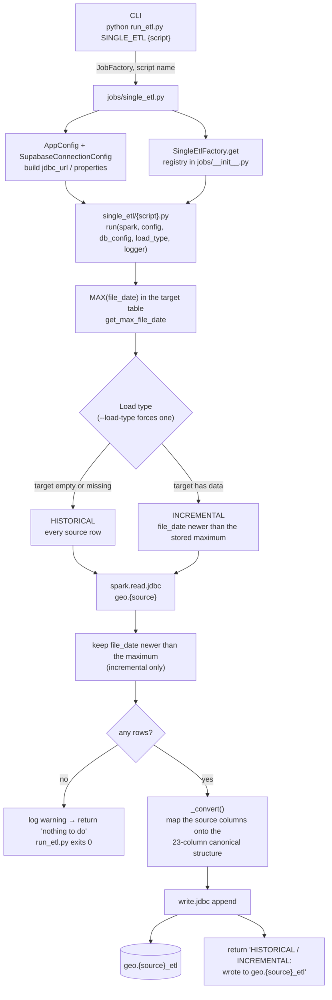

← [ETL jobs](../etl-jobs.md)

# SINGLE_ETL job

`jobs/single_etl.py` runs **one standalone PySpark script** from `single_etl/` — a complete read → transform → write pipeline for a single dataset, independent of the CREATE/INGESTION table pairs:



How the data flows:

1. `run_etl.py` resolves `JobType.SINGLE_ETL` → `jobs/single_etl.py` and passes the second positional argument as the **script name** — the file stem of a module in `single_etl/` (e.g. `avalanche_org_etl`).
2. `SingleEtlFactory` (`factory/single_etl_factory.py`) looks that name up in its registry; scripts are registered by `jobs/__init__.py`.
3. The job loads both configs and calls the script's `run(spark, config, db_config, load_type=..., logger=...)`.
4. The script resolves its [load type](load-types.md), reads its source table, applies its own `_convert()` transformation and appends the result to its target table.

```bash
python run_etl.py SINGLE_ETL avalanche_org_etl                    # auto load type
python run_etl.py SINGLE_ETL avalanche_org_etl --load-type historical
python run_etl.py SINGLE_ETL avalanche_org_etl --load-type incremental
```

`--load-type` accepts `auto` (default), `historical` or `incremental` and is rejected on any other job; the logs go to `logs/single_etl/single_etl_<script>_<timestamp>.log`. A run that finds nothing new warns and still exits `0` — the DATA_QUALITY behaviour, not the INGESTION one.

## avalanche_org_etl

`single_etl/avalanche_org_etl.py` is the reference script: `geo.avalanche_org` (one row per forecast zone per day) → `geo.avalanche_org_etl` (the 23-column structure from `model/etl/event_etl.py`).

| Target column | Source |
|---------------|--------|
| `subsource_name` | `center_name` (issuing center) |
| `place_location` | `zone_name`; `event_name` stays `NULL` — a forecast has no event name |
| `latitude` / `longitude` | polygon centroid of the zone from `cache/avalanche_zone_centroids.csv`, keyed `place_location` + `state_province` |
| `metric_name` | always `magnitude`; `metric_value` / `metric_unit` stay `NULL` — a danger level is a rating, not a measurement |
| `danger_rating` | zone rating as text, `NULL` while unrated (`danger_level = -1`, `danger_rating = "no rating"`) |
| `statement` | `travel_advice`, with `warning` appended when present |
| `event_start_date` | `date` (the forecast's calendar day) |
| `event_start` / `event_end` | `forecast_start` / `forecast_end` |
| `other_metrics` | `NULL` (zone ids and links are not metrics) |

When `cache/avalanche_zone_centroids.csv` is missing, the ETL builds it itself through `utils/fetch_avalanche_zones.py` — fetching today plus 10 and 30 days back, so zones that have left the avalanche.org feed stay covered — and only fails when that build fails (no network). To refresh the lookup or to pick the days yourself, run `python -m utils.fetch_avalanche_zones --day <day> [--day <day> …]` and rerun it whenever a zone is added or renamed. The CSV is parsed on the driver and embedded as literal columns, because the Spark containers only mount `GEO_Download/data`.

## eonet_event_etl

`single_etl/eonet_event_etl.py`: `geo.eonet_event` (NASA EONET hazard events) → `geo.eonet_event_etl` (the 23-column structure from `model/etl/event_etl.py`).

| Target column | Source |
|---------------|--------|
| `subsource_name` | `source_id` (reporting feed: `IRWIN`, `JTWC`, `NATICE`, `NOAA_NHC`, `EO`, `BYU_ICE`) |
| `event_name` | `event_name` |
| `event_category` | `category_id` → `storm` (`severeStorms`), `fire` (`wildfires`), `iceberg` (`seaLakeIce`); unknown ids are snake-cased (`volcanicAsh` → `volcanic_ash`) |
| `event_subcategory` | storm type parsed from `event_name` (`hurricane`, `typhoon`, `tropical storm`, `tropical cyclone`, `cyclone`); `wildfire` for fires; `sea_lake_ice` for ice; `NULL` when no keyword applies |
| `event_description` | `description`, `NULL` when blank |
| `latitude` / `longitude` | `latitude` / `longitude` — the event's own position |
| `country_code` / `state_province` | the US state at the end of `description` (fires: `… from Miles City, MT`), else the reverse-geocoded coordinate from `cache/reverse_geocode.csv`, else `ZZ` / `NULL` (open water) |
| `place_location` | `event_name` minus its type prefix (`Wildfire`, `Prescribed Fire`, `Incident Complex`, `Emergency Stabilization BAER`) when a place is left, e.g. `Wildfire Snow, Custer, Montana` → `Snow, Custer, Montana`; `NULL` for `Hurricane Polo` / `Iceberg D32` |
| `metric_name` | `wind speed` (storms), `area` (fires), `surface` (ice), `magnitude` for any other category |
| `metric_value` / `metric_unit` | `magnitude_value` / `magnitude_unit` |
| `danger_rating` / `statement` | `NULL` — EONET carries neither |
| `other_metrics` | `{"geometry_count": n}` — the event's geometry points |
| `event_start_date` / `event_start` | `event_date` |
| `event_end` | `last_date` |
| `last_latitude` / `last_longitude` | `last_latitude` / `last_longitude` — the latest position |
| `file_date` | `file_date` |

Coordinates missing from `cache/reverse_geocode.csv` are reverse-geocoded on the driver through `utils/reverse_geocode.py` (BigDataCloud, keyless) the first time they appear: successful answers are written back to the cache and reused by every later run, while a failed fetch stops the run before anything is written. The CSV is read on the driver and embedded as literal columns, because the Spark containers only mount `GEO_Download/data`. The API answers open water with an empty country (the `ZZ` fallback) and Antarctic coordinates with the continent, which maps to `AQ`.

## Adding a new script

1. Copy `single_etl/avalanche_org_etl.py` to `single_etl/<name>_etl.py` and rewrite `SOURCE_TABLE`, `TARGET_TABLE` and `_convert()` for the new source (the module docstring walks through it).
2. Register it in `jobs/__init__.py`:

```python
from single_etl.<name>_etl import run as <name>_etl_run

SingleEtlFactory.register("<name>_etl", <name>_etl_run)
```

3. Run it: `python run_etl.py SINGLE_ETL <name>_etl`.

