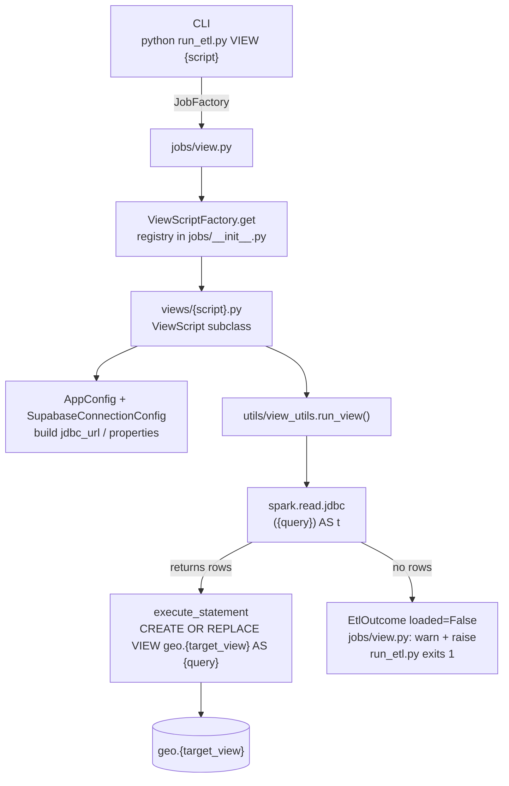

← [ETL jobs](../etl-jobs.md)

# VIEW job

`jobs/view.py` runs **one standalone PySpark script** from `views/` — a read → validate → define pipeline that turns a query over a `*_etl` table into a `*_vw` view. Each script is a `ViewScript` subclass (`views/view_script.py`) whose `run()` method delegates to the shared runner `utils/view_utils.run_view()`, fed the class's two object names and its query:



Unlike every other data job, the `VIEW` job needs **no `CREATE` run and no Pydantic model**: views are not tables, they are not registered in `TableFactory`, and the job itself stores the view definition in Supabase.

## Load type — HISTORICAL only

Views support exactly one load type:

| Condition | Load Type | Behavior |
|-----------|-----------|----------|
| Always | `HISTORICAL` | Re-runs the query over the `*_etl` source and replaces the whole view definition |
| Query returns no rows | `HISTORICAL` | Runner returns `loaded=False` → the job warns and raises `RuntimeError`, the existing view stays untouched |

A view has no `file_date` cursor to be incremental from, so there is nothing to detect or force: `--load-type` is rejected for this job the same way it is for every non-`SINGLE_ETL` job (`--load-type can only be used with the SINGLE_ETL job`). Details: [Load type detection — VIEW](load-types.md#view).

How the data flows:

1. `run_etl.py` parses the CLI args and resolves `JobType.VIEW` → `jobs/view.py` through `JobFactory`, passing the second positional argument as the **script name** — the file stem of a module in `views/` (e.g. `metrics_avalanche_vw`).
2. `ViewScriptFactory` (`factory/view_script_factory.py`) looks that name up in its registry; scripts are registered by `jobs/__init__.py`. Unknown names raise `ValueError`.
3. `AppConfig.from_json()` and `SupabaseConnectionConfig.from_env()` build the JDBC URL and properties used by both database calls below.
4. `run_view` (`utils/view_utils.py`) executes the script's query through Spark's JDBC reader as a `(<query>) AS t` subquery — proving the SQL is valid and returns at least one row. A trailing `;` in the configured query is tolerated and stripped.
5. No rows → the runner returns `EtlOutcome(loaded=False, …)`; `jobs/view.py` warns with that summary and raises `RuntimeError`, so `run_etl.py` exits with code 1 (same contract as SINGLE_ETL) and **the existing view is not touched**.
6. Rows → `execute_statement` runs `CREATE OR REPLACE VIEW geo.<target_view> AS <query>` over JDBC. The definition is stored in the database, which recomputes the view on every read — so the view always reflects the current contents of its `*_etl` source.

The query lives entirely in `config.json` (`datasets.view.<script>`, the `ViewDatasetConfig` model) — the script itself is only wiring. The registered views:

| Script | Source rows | Target view | Description |
|--------|-------------|-------------|-------------|
| `metrics_avalanche_vw` | `event_category = 'avalanche'` | `geo.metrics_avalanche_vw` | [below](#metrics_avalanche_vw) |
| `metrics_drought_vw` | `event_category = 'drought'` | `geo.metrics_drought_vw` | [below](#metrics_drought_vw) |
| `metrics_earthquake_vw` | `event_category = 'earthquake'` | `geo.metrics_earthquake_vw` | [below](#metrics_earthquake_vw) |
| `metrics_fire_vw` | `event_category = 'fire'` | `geo.metrics_fire_vw` | [below](#metrics_fire_vw) |

Both follow the same shape — own measured metric + numeric `other_metrics` explosion + trailing `file_date` — the avalanche entry:

```json
"view": {
  "metrics_avalanche_vw": {
    "source_table": "union_etl",
    "target_view": "metrics_avalanche_vw",
    "query": "WITH avalanche AS (SELECT ... FROM geo.union_etl WHERE event_category = 'avalanche'), other_metric AS (SELECT ... jsonb_each(other_metrics::jsonb) ...) SELECT ... FROM avalanche UNION ALL SELECT ... FROM other_metric"
  }
}
```

`source_table` is the `*_etl` table the view reads (it must appear in the query, schema-qualified as `geo.<table>`), `target_view` is the `*_vw` name the job creates.

Log lines written to `logs/view/view_<view_name>_<timestamp>.log` (logger output — nothing is printed to the terminal):

```
INFO ---- View started: geo.union_etl → geo.metrics_avalanche_vw ----
INFO Load type: HISTORICAL (the only load type views support)
INFO Running the query on geo.union_etl...
INFO Defining view geo.metrics_avalanche_vw...
INFO View complete: geo.metrics_avalanche_vw defined over geo.union_etl
INFO View metrics_avalanche_vw complete — HISTORICAL: defined view geo.metrics_avalanche_vw over geo.union_etl
```

An empty query result fails the run:

```
WARNING No records loaded into metrics_avalanche_vw — query returned no rows from union_etl
ERROR ETL job failed   (RuntimeError)   → exit code 1
```

## metrics_avalanche_vw

`views/metrics_avalanche_vw.py` (`datasets.view.metrics_avalanche_vw`): every avalanche-category metric of `geo.union_etl` flattened into one row per (name, value, unit) triple:

| Column | Content |
|--------|---------|
| `event_category`, `event_subcategory` | carried over from the source row (the category is always `avalanche`) |
| `metric_name`, `metric_value`, `metric_unit` | the row's own canonical metric — kept only when it carries a value (bare names with NULL value/unit, such as `size`, are skipped) — and, **appended** as extra rows, one row per numeric entry of its `other_metrics` JSON, with the unit taken from the companion `<name>_unit` key |
| `file_date` | the source row's `YYYY-MM-DD` snapshot stamp, cast to `timestamp` (trailing column) |

So a zone publishing `metric_name = 'size'` with no value alongside `{"danger_level": 3, "danger_level_unit": "NAPADS level", "off_season": false}` yields one row: `danger_level` / `3` / `NAPADS level` (the unmeasured `size` name is dropped). In today's data every avalanche row's own metric is exactly such a bare `size` name, so the view currently carries the exploded `other_metrics` rows only — 4,426 `danger_level` rows. Companion `*_unit` keys are units, not metrics, and non-numeric entries (free text / booleans such as `warning`, `off_season`) carry no measurement and are skipped — the explosion happens in the database (`jsonb_each` + `jsonb_typeof(...) = 'number'` inside the configured query).

```bash
python run_etl.py VIEW metrics_avalanche_vw
```

## metrics_drought_vw

`views/metrics_drought_vw.py` (`datasets.view.metrics_drought_vw`): the drought twin of the avalanche view — the same query shape, filtered to `event_category = 'drought'` and reading `geo.union_etl`. Every drought row keeps its measured own metric (GDACS publishes `area` / `km²`), `event_category` / `event_subcategory` (e.g. `agricultural drought`), and trailing `file_date` (`timestamp`), with the numeric `other_metrics` explosion appended when present.

GDACS currently writes `other_metrics = NULL` for drought rows, so the explosion branch yields no rows today — it is kept so the view behaves identically if other sources start publishing drought rows with `other_metrics`. Live shape: 403 rows, one per drought event/date, `area` in `km²` over `2026-09-01` → `2026-10-20`.

```bash
python run_etl.py VIEW metrics_drought_vw
```

## metrics_earthquake_vw

`views/metrics_earthquake_vw.py` (`datasets.view.metrics_earthquake_vw`): the earthquake twin of the avalanche view — same query shape, filtered to `event_category = 'earthquake'` over `geo.union_etl`. Unlike drought, its `other_metrics` explosion is fully active: USGS rows carry numeric `depth` / `km` and `nst` / `stations` entries there (NULL `other_metrics` on ~1.5k rows contribute only their own metric). The rare magnitude scales `mh`, `Mi`, `mun` and `ms_vx` (1-14 records each) are excluded from both branches via `metric_unit NOT IN (...)` — only `Mw` remains.

Live shape: 47,698 rows — 16,877 `magnitude` / `Mw` plus 15,411 `depth` / `km` and 15,410 `nst` / `stations` from the explosion; every row measured, every unit populated.

```bash
python run_etl.py VIEW metrics_earthquake_vw
```

## metrics_fire_vw

`views/metrics_fire_vw.py` (`datasets.view.metrics_fire_vw`): the fire twin of the avalanche view — same query shape, filtered to `event_category = 'fire'` over `geo.union_etl`. The `other_metrics` explosion mixes two sources: NIFC contributes `percent_contained` / `%` (its `_other_metrics()` always writes the companion), and EONET fire rows contribute `geometry_count` (the event's geometry points — a count with **no companion unit**, so those rows carry `metric_unit = NULL`; drop them with a `metric_unit IS NOT NULL` predicate if unwanted).

Live shape: 12,374 rows — 11,942 own `area` / `km²` rows (all fire sources publish it), 343 `percent_contained` / `%` and 89 `geometry_count` / NULL from the explosion.

```bash
python run_etl.py VIEW metrics_fire_vw
```

## Dropping a view

`run_drop_table.py` issues `DROP TABLE`, which PostgreSQL rejects for a view. Drop a view with SQL instead:

```sql
DROP VIEW IF EXISTS geo.metrics_avalanche_vw;
```

The next `python run_etl.py VIEW metrics_avalanche_vw` recreates it.

> PostgreSQL only lets `CREATE OR REPLACE VIEW` **append** new columns at the end of the column list — reordering or inserting a column earlier (like moving the view's trailing `file_date`) fails with *"cannot change name of view column ..."*. Drop the view once (as above) and re-run the job to get a new column order; from then on, plain `CREATE OR REPLACE` runs work again as long as the order is kept.

## Adding a new view script

1. Add a `datasets.view.<name>_vw` entry to `config.json` — `source_table` (the `*_etl` table), `target_view` (the `*_vw` name) and the `query` the view exposes. `ViewDatasetConfig` (`model/config/datasets.py`) already validates all three fields; no new model is needed unless the entry carries extra constants.
2. Create `views/<name>_vw.py` (the pattern of the existing [`metrics_avalanche_vw` script](#metrics_avalanche_vw)):

```python
from model.config.datasets import ViewDatasetConfig, load_dataset
from views.view_script import ViewScript

_cfg = load_dataset(__file__, "view", ViewDatasetConfig)


class FloodMetricsVwScript(ViewScript):
    SOURCE_TABLE = _cfg.source_table
    TARGET_VIEW = _cfg.target_view
    QUERY = _cfg.query
```

3. Register an instance in `jobs/__init__.py`:

```python
from views.<name>_vw import <Name>VwScript

_script = <Name>VwScript()
ViewScriptFactory.register(_script.TARGET_VIEW, _script)
```

4. Run it: `python run_etl.py VIEW <name>_vw`.
