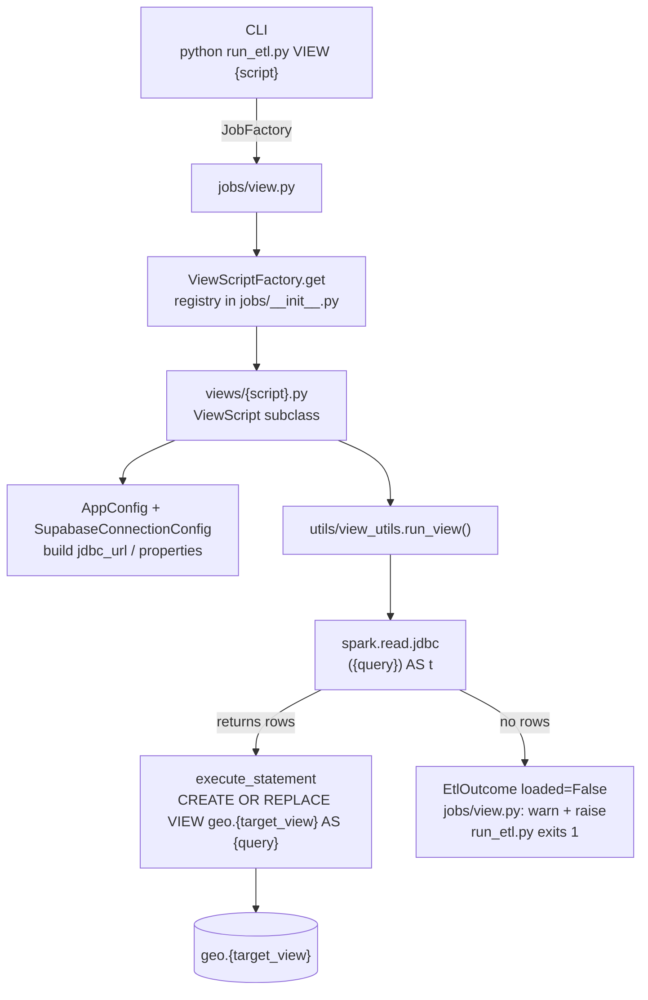

← [ETL jobs](../etl-jobs.md)

# VIEW job

`jobs/view.py` runs **one standalone PySpark script** from `views/` — a read → validate → define pipeline that turns a configured query (usually over a `*_etl` table or another view) into a `*_vw` view. Each script is a `ViewScript` subclass (`views/view_script.py`) whose `run()` method delegates to the shared runner `utils/view_utils.run_view()`, fed the class's two object names and its query:



Unlike every other data job, the `VIEW` job needs **no `CREATE` run and no Pydantic model**: views are not tables, they are not registered in `TableFactory`, and the job itself stores the view definition in Supabase.

## Load type — HISTORICAL only

Views support exactly one load type:

| Condition | Load Type | Behavior |
|-----------|-----------|----------|
| Always | `HISTORICAL` | Re-runs the query over the `*_etl` source and replaces the whole view definition |
| Query returns no rows | `HISTORICAL` | Runner returns `loaded=False` → the job warns and raises `RuntimeError`, the existing view stays untouched |

A view has no `file_date` cursor to be incremental from, so there is nothing to detect or force: `--load-type` is rejected for this job the same way it is for every non-`SINGLE_ETL` job (`--load-type can only be used with the SINGLE_ETL or DATA_SOURCE_FILE job`). Details: [Load type detection — VIEW](load-types.md#view).

How the data flows:

1. `run_etl.py` parses the CLI args and resolves `JobType.VIEW` → `jobs/view.py` through `JobFactory`, passing the second positional argument as the **script name** — the file stem of a module in `views/` (e.g. `metrics_avalanche_vw`).
2. `ViewScriptFactory` (`factory/view_script_factory.py`) looks that name up in its registry; scripts are registered by `jobs/__init__.py`. Unknown names raise `ValueError`.
3. `AppConfig.from_json()` and `SupabaseConnectionConfig.from_env()` build the JDBC URL and properties used by both database calls below.
4. `run_view` (`utils/view_utils.py`) executes the script's query through Spark's JDBC reader as a `(<query>) AS t` subquery — proving the SQL is valid and returns at least one row. The query may read any schema object; the combined metrics views read `geo.metrics_observed_vw` and `geo.prediction_etl`. A trailing `;` in the configured query is tolerated and stripped.
5. No rows → the runner returns `EtlOutcome(loaded=False, …)`; `jobs/view.py` warns with that summary and raises `RuntimeError`, so `run_etl.py` exits with code 1 (same contract as SINGLE_ETL) and **the existing view is not touched**.
6. Rows → `execute_statement` runs `CREATE OR REPLACE VIEW geo.<target_view> AS <query>` over JDBC. The definition is stored in the database, which recomputes the view on every read — so the view always reflects the current contents of its `*_etl` source.

The query — and, for the five regional phenomenon views, the sorted `country_codes` whitelist — lives entirely in `config.json` (`datasets.view.<script>`, the `ViewDatasetConfig` model) — the script itself is only wiring. The registered views:

| Script | Source rows | Target view | Description |
|--------|-------------|-------------|-------------|
| `metrics_observed_vw` | `event_category IN ('avalanche', …, 'volcano')` | `geo.metrics_observed_vw` | [shared observed metrics](view/metrics-views.md#metrics_observed_vw) |
| `metrics_avalanche_vw` | observed `avalanche` rows + predicted dates | `geo.metrics_avalanche_vw` | [metrics view](view/metrics-views.md#metrics_avalanche_vw) |
| `metrics_drought_vw` | observed `drought` rows + predicted dates | `geo.metrics_drought_vw` | [metrics view](view/metrics-views.md#metrics_drought_vw) |
| `metrics_earthquake_vw` | observed `earthquake` rows + predicted dates | `geo.metrics_earthquake_vw` | [metrics view](view/metrics-views.md#metrics_earthquake_vw) |
| `metrics_fire_vw` | observed `fire` rows + predicted dates | `geo.metrics_fire_vw` | [metrics view](view/metrics-views.md#metrics_fire_vw) |
| `metrics_flood_vw` | observed `flood` rows + predicted dates | `geo.metrics_flood_vw` | [metrics view](view/metrics-views.md#metrics_flood_vw) |
| `metrics_iceberg_vw` | observed `iceberg` rows + predicted dates | `geo.metrics_iceberg_vw` | [metrics view](view/metrics-views.md#metrics_iceberg_vw) |
| `metrics_storm_vw` | observed `storm` rows + predicted dates | `geo.metrics_storm_vw` | [metrics view](view/metrics-views.md#metrics_storm_vw) |
| `metrics_volcano_vw` | observed `volcano` rows + predicted dates | `geo.metrics_volcano_vw` | [metrics view](view/metrics-views.md#metrics_volcano_vw) |
| `phenomenons_us_vw` | `country_code = 'US'` | `geo.phenomenons_us_vw` | [map view](view/phenomenon-views.md#phenomenons_us_vw) |
| `phenomenons_ca_vw` | `country_code = 'CA'` | `geo.phenomenons_ca_vw` | [map view](view/phenomenon-views.md#phenomenons_ca_vw) |
| `phenomenons_cs_amer_vw` | `country_code IN (<Americas ISO list>)` | `geo.phenomenons_cs_amer_vw` | [map view](view/phenomenon-views.md#phenomenons_cs_amer_vw) |
| `phenomenons_ru_vw` | `country_code = 'RU'` | `geo.phenomenons_ru_vw` | [map view](view/phenomenon-views.md#phenomenons_ru_vw) |
| `phenomenons_europe_vw` | `country_code IN (<Europe ISO list>)` | `geo.phenomenons_europe_vw` | [map view](view/phenomenon-views.md#phenomenons_europe_vw) |
| `phenomenons_asia_vw` | `country_code IN (<Asia ISO list>)` | `geo.phenomenons_asia_vw` | [map view](view/phenomenon-views.md#phenomenons_asia_vw) |
| `phenomenons_africa_vw` | `country_code IN (<Africa ISO list>)` | `geo.phenomenons_africa_vw` | [map view](view/phenomenon-views.md#phenomenons_africa_vw) |
| `phenomenons_aus_oc_vw` | `country_code IN (<Oceania ISO list>)` | `geo.phenomenons_aus_oc_vw` | [map view](view/phenomenon-views.md#phenomenons_aus_oc_vw) |
| `phenomenons_waters_vw` | `ZZ ∪ sea_lake_ice ∪ maritime keywords` | `geo.phenomenons_waters_vw` | [map view](view/phenomenon-views.md#phenomenons_waters_vw) |

The five regional `phenomenons_*_vw` entries carry a sorted `country_codes` whitelist; the script exposes it as `COUNTRY_CODES` and the query must use the same list. `ViewDatasetConfig` rejects duplicates, unsorted codes and non-ISO codes when the script is imported.

`metrics_observed_vw` extracts every observed metric from `geo.union_etl`; each of the eight `metrics_*_vw` views then unions its category's observed rows with the predicted rows from `geo.prediction_etl`. The denormalized per-country/region map views read `geo.union_etl` directly — see [Metrics views](view/metrics-views.md) and [Phenomenon views](view/phenomenon-views.md).

The eight metrics twins follow the same shape — own measured metric + numeric `other_metrics` explosion + trailing `file_date`, then predicted rows appended — the avalanche entry:

```json
"view": {
  "metrics_observed_vw": {
    "source_table": "union_etl",
    "target_view": "metrics_observed_vw",
    "query": "WITH observed AS (SELECT ... FROM geo.union_etl WHERE event_category IN (...)), own_metric AS (...), other_metric AS (...) SELECT ..., FALSE AS is_predicted FROM own_metric UNION ALL SELECT ..., FALSE AS is_predicted FROM other_metric"
  },
  "metrics_avalanche_vw": {
    "source_table": "metrics_observed_vw",
    "target_view": "metrics_avalanche_vw",
    "query": "SELECT ..., is_predicted FROM geo.metrics_observed_vw WHERE event_category = 'avalanche' UNION ALL SELECT ..., predicted_value AS metric_value, ..., is_predicted FROM geo.prediction_etl WHERE event_category = 'avalanche'"
  }
}
```

`source_table` is the primary source the view reads (it must appear in the query, schema-qualified as `geo.<table>`), `target_view` is the `*_vw` name the job creates. The combined metrics views also read `geo.prediction_etl`; `source_table` names the observed view.

Log lines written to `logs/view/view_<view_name>_<timestamp>.log` (logger output — nothing is printed to the terminal):

```
INFO ---- View started: geo.union_etl → geo.metrics_observed_vw ----
INFO Load type: HISTORICAL (the only load type views support)
INFO Running the query on geo.union_etl...
INFO Defining view geo.metrics_observed_vw...
INFO View complete: geo.metrics_observed_vw defined over geo.union_etl
INFO View metrics_observed_vw complete — HISTORICAL: defined view geo.metrics_observed_vw over geo.union_etl
```

An empty query result fails the run:

```
WARNING No records loaded into metrics_observed_vw — query returned no rows from union_etl
ERROR ETL job failed   (RuntimeError)   → exit code 1
```

## View scripts

The registered views fall into two families:

- [Metrics views](view/metrics-views.md) — the shared `metrics_observed_vw` plus one
  `metrics_*_vw` per `event_category` (all eight categories): the observed row's own metric
  and numeric `other_metrics` entries, unioned with MLlib predictions for missing dates.
  Every row carries `is_predicted`.
- [Phenomenon views](view/phenomenon-views.md) — the denormalized per-country/region
  `phenomenons_*_vw` views shaped for Looker Studio, sharing the US view's 15-column
  display query and differing only in their country filter (plus the water heuristic).

Each page documents the query shape, live row counts and the pinned invariants for its
views.

## Dropping a view

`run_drop_table.py` issues `DROP TABLE`, which PostgreSQL rejects for a view. Drop a view with SQL instead:

```sql
DROP VIEW IF EXISTS geo.metrics_avalanche_vw;
```

The next `python run_etl.py VIEW metrics_avalanche_vw` recreates it.

> PostgreSQL only lets `CREATE OR REPLACE VIEW` **append** new columns at the end of the column list — reordering or inserting a column earlier (like moving the view's trailing `file_date`) fails with *"cannot change name of view column ..."*. Drop the view once (as above) and re-run the job to get a new column order; from then on, plain `CREATE OR REPLACE` runs work again as long as the order is kept.

## Adding a new view script

1. Add a `datasets.view.<name>_vw` entry to `config.json` — `source_table` (the `*_etl` table), `target_view` (the `*_vw` name) and the `query` the view exposes. `ViewDatasetConfig` (`model/config/datasets.py`) already validates all three fields; no new model is needed unless the entry carries extra constants.
2. Create `views/<name>_vw.py` (the pattern of the existing [`metrics_avalanche_vw` script](#metrics_avalanche_vw)):

```python
from model.config.datasets import ViewDatasetConfig, load_dataset
from views.view_script import ViewScript

_cfg = load_dataset(__file__, "view", ViewDatasetConfig)


class FloodMetricsVwScript(ViewScript):
    SOURCE_TABLE = _cfg.source_table
    TARGET_VIEW = _cfg.target_view
    QUERY = _cfg.query
```

3. Register an instance in `jobs/__init__.py`:

```python
from views.<name>_vw import <Name>VwScript

_script = <Name>VwScript()
ViewScriptFactory.register(_script.TARGET_VIEW, _script)
```

4. Run it: `python run_etl.py VIEW <name>_vw`.
