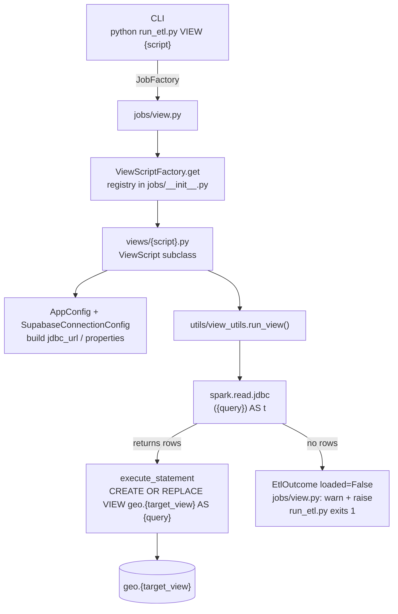

← [ETL jobs](../etl-jobs.md)

# VIEW job

`jobs/view.py` runs **one standalone PySpark script** from `views/` — a read → validate → define pipeline that turns a query over a `*_etl` table into a `*_vw` view. Each script is a `ViewScript` subclass (`views/view_script.py`) whose `run()` method delegates to the shared runner `utils/view_utils.run_view()`, fed the class's two object names and its query:



Unlike every other data job, the `VIEW` job needs **no `CREATE` run and no Pydantic model**: views are not tables, they are not registered in `TableFactory`, and the job itself stores the view definition in Supabase.

## Load type — HISTORICAL only

Views support exactly one load type:

| Condition | Load Type | Behavior |
|-----------|-----------|----------|
| Always | `HISTORICAL` | Re-runs the query over the `*_etl` source and replaces the whole view definition |
| Query returns no rows | `HISTORICAL` | Runner returns `loaded=False` → the job warns and raises `RuntimeError`, the existing view stays untouched |

A view has no `file_date` cursor to be incremental from, so there is nothing to detect or force: `--load-type` is rejected for this job the same way it is for every non-`SINGLE_ETL` job (`--load-type can only be used with the SINGLE_ETL job`). Details: [Load type detection — VIEW](load-types.md#view).

How the data flows:

1. `run_etl.py` parses the CLI args and resolves `JobType.VIEW` → `jobs/view.py` through `JobFactory`, passing the second positional argument as the **script name** — the file stem of a module in `views/` (e.g. `metrics_avalanche_vw`).
2. `ViewScriptFactory` (`factory/view_script_factory.py`) looks that name up in its registry; scripts are registered by `jobs/__init__.py`. Unknown names raise `ValueError`.
3. `AppConfig.from_json()` and `SupabaseConnectionConfig.from_env()` build the JDBC URL and properties used by both database calls below.
4. `run_view` (`utils/view_utils.py`) executes the script's query through Spark's JDBC reader as a `(<query>) AS t` subquery — proving the SQL is valid and returns at least one row. A trailing `;` in the configured query is tolerated and stripped.
5. No rows → the runner returns `EtlOutcome(loaded=False, …)`; `jobs/view.py` warns with that summary and raises `RuntimeError`, so `run_etl.py` exits with code 1 (same contract as SINGLE_ETL) and **the existing view is not touched**.
6. Rows → `execute_statement` runs `CREATE OR REPLACE VIEW geo.<target_view> AS <query>` over JDBC. The definition is stored in the database, which recomputes the view on every read — so the view always reflects the current contents of its `*_etl` source.

The query lives entirely in `config.json` (`datasets.view.<script>`, the `ViewDatasetConfig` model) — the script itself is only wiring. The registered views:

| Script | Source rows | Target view | Description |
|--------|-------------|-------------|-------------|
| `metrics_avalanche_vw` | `event_category = 'avalanche'` | `geo.metrics_avalanche_vw` | [below](#metrics_avalanche_vw) |
| `metrics_drought_vw` | `event_category = 'drought'` | `geo.metrics_drought_vw` | [below](#metrics_drought_vw) |
| `metrics_earthquake_vw` | `event_category = 'earthquake'` | `geo.metrics_earthquake_vw` | [below](#metrics_earthquake_vw) |
| `metrics_fire_vw` | `event_category = 'fire'` | `geo.metrics_fire_vw` | [below](#metrics_fire_vw) |
| `metrics_flood_vw` | `event_category = 'flood'` | `geo.metrics_flood_vw` | [below](#metrics_flood_vw) |
| `metrics_iceberg_vw` | `event_category = 'iceberg'` | `geo.metrics_iceberg_vw` | [below](#metrics_iceberg_vw) |
| `metrics_storm_vw` | `event_category = 'storm'` | `geo.metrics_storm_vw` | [below](#metrics_storm_vw) |
| `metrics_volcano_vw` | `event_category = 'volcano'` | `geo.metrics_volcano_vw` | [below](#metrics_volcano_vw) |
| `phenomenons_us_vw` | `country_code = 'US'` | `geo.phenomenons_us_vw` | [below](#phenomenons_us_vw) |
| `phenomenons_ca_vw` | `country_code = 'CA'` | `geo.phenomenons_ca_vw` | [below](#phenomenons_ca_vw) |
| `phenomenons_cs_amer_vw` | `country_code IN (<Americas ISO list>)` | `geo.phenomenons_cs_amer_vw` | [below](#phenomenons_cs_amer_vw) |
| `phenomenons_ru_vw` | `country_code = 'RU'` | `geo.phenomenons_ru_vw` | [below](#phenomenons_ru_vw) |
| `phenomenons_europe_vw` | `country_code IN (<Europe ISO list>)` | `geo.phenomenons_europe_vw` | [below](#phenomenons_europe_vw) |
| `phenomenons_asia_vw` | `country_code IN (<Asia ISO list>)` | `geo.phenomenons_asia_vw` | [below](#phenomenons_asia_vw) |
| `phenomenons_africa_vw` | `country_code IN (<Africa ISO list>)` | `geo.phenomenons_africa_vw` | [below](#phenomenons_africa_vw) |
| `phenomenons_aus_oc_vw` | `country_code IN (<Oceania ISO list>)` | `geo.phenomenons_aus_oc_vw` | [below](#phenomenons_aus_oc_vw) |
| `phenomenons_waters_vw` | `ZZ ∪ sea_lake_ice ∪ maritime keywords` | `geo.phenomenons_waters_vw` | [below](#phenomenons_waters_vw) |

One `metrics_*` view per `event_category` of `geo.union_etl` (all eight categories), plus the denormalized per-country/region map views — see the sections below.

The eight metrics twins follow the same shape — own measured metric + numeric `other_metrics` explosion + trailing `file_date` — the avalanche entry:

```json
"view": {
  "metrics_avalanche_vw": {
    "source_table": "union_etl",
    "target_view": "metrics_avalanche_vw",
    "query": "WITH avalanche AS (SELECT ... FROM geo.union_etl WHERE event_category = 'avalanche'), other_metric AS (SELECT ... jsonb_each(other_metrics::jsonb) ...) SELECT ... FROM avalanche UNION ALL SELECT ... FROM other_metric"
  }
}
```

`source_table` is the `*_etl` table the view reads (it must appear in the query, schema-qualified as `geo.<table>`), `target_view` is the `*_vw` name the job creates.

Log lines written to `logs/view/view_<view_name>_<timestamp>.log` (logger output — nothing is printed to the terminal):

```
INFO ---- View started: geo.union_etl → geo.metrics_avalanche_vw ----
INFO Load type: HISTORICAL (the only load type views support)
INFO Running the query on geo.union_etl...
INFO Defining view geo.metrics_avalanche_vw...
INFO View complete: geo.metrics_avalanche_vw defined over geo.union_etl
INFO View metrics_avalanche_vw complete — HISTORICAL: defined view geo.metrics_avalanche_vw over geo.union_etl
```

An empty query result fails the run:

```
WARNING No records loaded into metrics_avalanche_vw — query returned no rows from union_etl
ERROR ETL job failed   (RuntimeError)   → exit code 1
```

## metrics_avalanche_vw

`views/metrics_avalanche_vw.py` (`datasets.view.metrics_avalanche_vw`): every avalanche-category metric of `geo.union_etl` flattened into one row per (name, value, unit) triple:

| Column | Content |
|--------|---------|
| `event_category`, `event_subcategory` | carried over from the source row (the category is always `avalanche`) |
| `metric_name`, `metric_value`, `metric_unit` | the row's own canonical metric — kept only when it carries a value (bare names with NULL value/unit, such as `size`, are skipped) — and, **appended** as extra rows, one row per numeric entry of its `other_metrics` JSON, with the unit taken from the companion `<name>_unit` key |
| `file_date` | the source row's `YYYY-MM-DD` snapshot stamp, cast to `timestamp` (trailing column) |

So a zone publishing `metric_name = 'size'` with no value alongside `{"danger_level": 3, "danger_level_unit": "NAPADS level", "off_season": false}` yields one row: `danger_level` / `3` / `NAPADS level` (the unmeasured `size` name is dropped). In today's data every avalanche row's own metric is exactly such a bare `size` name, so the view currently carries the exploded `other_metrics` rows only — 4,426 `danger_level` rows. Companion `*_unit` keys are units, not metrics, and non-numeric entries (free text / booleans such as `warning`, `off_season`) carry no measurement and are skipped — the explosion happens in the database (`jsonb_each` + `jsonb_typeof(...) = 'number'` inside the configured query).

```bash
python run_etl.py VIEW metrics_avalanche_vw
```

## metrics_drought_vw

`views/metrics_drought_vw.py` (`datasets.view.metrics_drought_vw`): the drought twin of the avalanche view — the same query shape, filtered to `event_category = 'drought'` and reading `geo.union_etl`. Every drought row keeps its measured own metric (GDACS publishes `area` / `km²`), `event_category` / `event_subcategory` (e.g. `agricultural drought`), and trailing `file_date` (`timestamp`), with the numeric `other_metrics` explosion appended when present.

GDACS currently writes `other_metrics = NULL` for drought rows, so the explosion branch yields no rows today — it is kept so the view behaves identically if other sources start publishing drought rows with `other_metrics`. Live shape: 403 rows, one per drought event/date, `area` in `km²` over `2026-09-01` → `2026-10-20`.

```bash
python run_etl.py VIEW metrics_drought_vw
```

## metrics_earthquake_vw

`views/metrics_earthquake_vw.py` (`datasets.view.metrics_earthquake_vw`): the earthquake twin of the avalanche view — same query shape, filtered to `event_category = 'earthquake'` over `geo.union_etl`. Unlike drought, its `other_metrics` explosion is fully active: USGS rows carry numeric `depth` / `km` and `nst` / `stations` entries there (NULL `other_metrics` on ~1.5k rows contribute only their own metric). The rare magnitude scales `mh`, `Mi`, `mun` and `ms_vx` (1-14 records each) are excluded from both branches via `metric_unit NOT IN (...)` — only `Mw` remains.

Live shape: 47,698 rows — 16,877 `magnitude` / `Mw` plus 15,411 `depth` / `km` and 15,410 `nst` / `stations` from the explosion; every row measured, every unit populated.

```bash
python run_etl.py VIEW metrics_earthquake_vw
```

## metrics_fire_vw

`views/metrics_fire_vw.py` (`datasets.view.metrics_fire_vw`): the fire twin of the avalanche view — same query shape, filtered to `event_category = 'fire'` over `geo.union_etl`. The `other_metrics` explosion mixes two sources: NIFC contributes `percent_contained` / `%` (its `_other_metrics()` always writes the companion), and EONET fire rows contribute `geometry_count` (the event's geometry points — a count with **no companion unit**, so those rows carry `metric_unit = NULL`; drop them with a `metric_unit IS NOT NULL` predicate if unwanted).

Live shape: 12,374 rows — 11,942 own `area` / `km²` rows (all fire sources publish it), 343 `percent_contained` / `%` and 89 `geometry_count` / NULL from the explosion.

```bash
python run_etl.py VIEW metrics_fire_vw
```

## metrics_flood_vw

`views/metrics_flood_vw.py` (`datasets.view.metrics_flood_vw`): the flood twin of the avalanche view — same query shape, filtered to `event_category = 'flood'` over `geo.union_etl`. Both branches carry a five-metric whitelist (`metric_name IN ('discharge', 'threshold', 'baseline_days', 'exceedance_ratio', 'magnitude')`), so only those metrics ever reach the view: the OPENMETEO percentile/ensemble block and the USGS_NWIS stage metrics found in its rich `other_metrics` JSON are filtered out, as are any future keys. Units come from the companion `<name>_unit` keys (`discharge` and `threshold` in `m³/s`); `baseline_days`, `exceedance_ratio` and GDACS's own `magnitude` land with `metric_unit = NULL`. Non-numeric entries (`threshold_exceeded`, dates, gauge ids, `exceedance_level`) are skipped by the numeric filter.

Live shape: 45,589 rows — 11,635 `discharge` / `m³/s` + 570 `magnitude` / NULL own metrics, and 11,544 `threshold` / `m³/s`, 11,544 `baseline_days` / NULL, 10,296 `exceedance_ratio` / NULL from the explosion.

```bash
python run_etl.py VIEW metrics_flood_vw
```

## metrics_iceberg_vw

`views/metrics_iceberg_vw.py` (`datasets.view.metrics_iceberg_vw`): the iceberg twin of the avalanche view — same query shape, filtered to `event_category = 'iceberg'` over `geo.union_etl`. All 61 rows are EONET `sea_lake_ice` events: the own metric is `surface` / `N/m²`, and every row's `other_metrics` holds `geometry_count` (the event's geometry points — a count with no companion unit, so those rows carry `metric_unit = NULL`, as with fire).

Live shape: 122 rows — 61 `surface` / `N/m²` own metrics + 61 `geometry_count` / NULL from the explosion.

```bash
python run_etl.py VIEW metrics_iceberg_vw
```

## metrics_storm_vw

`views/metrics_storm_vw.py` (`datasets.view.metrics_storm_vw`): the storm twin of the avalanche view — same query shape, filtered to `event_category = 'storm'` over `geo.union_etl`. Every source publishes the own metric `wind speed` / `km/h` (IBTRACS 1,593, GDACS 209, EONET 123; GDACS rows have NULL `other_metrics` and contribute only it). The explosion adds the IBTRACS block — `pressure` / `mb`, `speed` / `km/h`, `direction` / `degrees`, `gust` / `km/h` (444 rows) and `dist2land` / `landfall` / `km` — plus EONET's unit-less `geometry_count` (NULL unit). The `saffir_simpson` class is a string and is skipped by the numeric filter.

Live shape: 10,372 rows — 1,925 own `wind speed` rows + 8,447 exploded rows across 7 metric names.

```bash
python run_etl.py VIEW metrics_storm_vw
```

## metrics_volcano_vw

`views/metrics_volcano_vw.py` (`datasets.view.metrics_volcano_vw`): the volcano twin of the avalanche view — same query shape, filtered to `event_category = 'volcano'` over `geo.union_etl`. Own metrics: USGS's `vei` / `VEI` (80 rows) and GDACS's `magnitude` / NULL (8 rows, NULL `other_metrics`). The explosion adds USGS notice numbers `vnum` / `Smithsonian GVP` (an identifier in numeric form — exclude with `metric_name != 'vnum'` if unwanted) and, on damage-affected volcanoes, `casualties` / `people` and `damage` / `million USD` (21 rows each). `color_code`, `alert_level` and `notice_identifier` are strings and are skipped by the numeric filter.

Live shape: 210 rows — 88 own metrics + 80 `vnum` + 21 `casualties` + 21 `damage`.

```bash
python run_etl.py VIEW metrics_volcano_vw
```

## phenomenons_us_vw

`views/phenomenons_us_vw.py` (`datasets.view.phenomenons_us_vw`): **not** a metrics twin — a denormalized, one-row-per-snapshot view of the United States rows (`country_code = 'US'`) of `geo.union_etl`, shaped for **map visualization in Looker Studio**. Every reshape happens in the SQL query:

| Column | Content |
|--------|---------|
| `event_category`, `event_subcategory` | `initcap()`-capitalized (`earthquake` → `Earthquake`) |
| `event_ndesc` | display name: `event_name` (fallback: capitalized category) + `":\n\n" + event_description` when a description exists |
| `latitude`, `longitude`, `country_code`, `state_province`, `place_location` | map pin + tooltip fields |
| `danger_rating` | the row's categorical rating passed through (`low` / `medium` / `high` / `extreme` / `none` / `no_rating`) |
| `metric_name`, `metric_value`, `metric_unit` | the row's own metric, passed through |
| `other_metrics` | Looker-friendly text: `key: value (unit)` pairs joined by `"; "` (e.g. `danger_level: -1 (NAPADS level); off_season: true`), `*_unit` companions consumed |
| `event_start_date` | `event_start`, falling back to midnight of `file_date` when NULL |
| `event_end_date` | `event_end` as stored (NULL until an event ends) |

Live shape: 20,187 rows (earthquake 14,098, avalanche 4,426, flood 1,057, fire 452, volcano 80, storm 49, drought 25 — no US icebergs).

```bash
python run_etl.py VIEW phenomenons_us_vw
```

## phenomenons_ca_vw

`views/phenomenons_ca_vw.py` (`datasets.view.phenomenons_ca_vw`): the Canada twin — the **identical** display query as [`phenomenons_us_vw`](#phenomenons_us_vw) (same 15 columns and reshapes) with `WHERE country_code = 'CA'`. A test pins that invariant: swapping `US` → `CA` in the US query must produce the CA query exactly.

Live shape: 809 rows (flood 737, earthquake 69, storm 2, fire 1).

```bash
python run_etl.py VIEW phenomenons_ca_vw
```

## phenomenons_cs_amer_vw

`views/phenomenons_cs_amer_vw.py` (`datasets.view.phenomenons_cs_amer_vw`): the third map twin — **byte-identical** `SELECT` to [`phenomenons_us_vw`](#phenomenons_us_vw), filtered to **both Americas without the United States and Canada**:

```sql
WHERE country_code IN ('AG','AI','AR','AW','BB','BL','BO','BQ','BR','BS','BZ','CL','CO','CR','CU','CW',
                       'DM','DO','EC','FK','GD','GF','GL','GP','GT','GY','HN','HT','JM','KN','LC','MF',
                       'MQ','MS','MX','NI','PA','PE','PM','PR','PY','SR','SX','TC','TT','UY','VC','VE','VG','VI')
```

The list is every ISO 3166-1 alpha-2 code of the Americas (UN M49 Northern + Central + South America and the Caribbean — countries *and* territories, since GDACS/seismic catalogs assign them) minus `US`/`CA`. A bare `NOT IN ('US','CA')` would wrongly include Europe, Africa, Asia and Oceania. The same tuple is exported as `COUNTRY_CODES` from the script, and tests pin: query `SELECT` == US view's, whitelist == `COUNTRY_CODES`, `US`/`CA`/`ZZ` absent.

Live shape: 4,495 rows across 27 country codes (largest: BR, MX, CO, AR, PA).

```bash
python run_etl.py VIEW phenomenons_cs_amer_vw
```

## phenomenons_ru_vw

`views/phenomenons_ru_vw.py` (`datasets.view.phenomenons_ru_vw`): the Russia twin — the **identical** display query as [`phenomenons_us_vw`](#phenomenons_us_vw) (same 15 columns and reshapes) with `WHERE country_code = 'RU'`. A test pins that invariant: swapping `US` → `RU` in the US query must produce the RU query exactly.

Live shape: 995 rows (flood 728, fire 135, earthquake 131, volcano 1).

```bash
python run_etl.py VIEW phenomenons_ru_vw
```

## phenomenons_europe_vw

`views/phenomenons_europe_vw.py` (`datasets.view.phenomenons_europe_vw`): the Europe twin — **byte-identical** `SELECT` to [`phenomenons_us_vw`](#phenomenons_us_vw), filtered to **strict UN M49 Europe without Russia**:

```sql
WHERE country_code IN ('AD','AL','AT','AX','BA','BE','BG','BY','CH','CZ','DE','DK','EE','ES','FI','FO','FR',
                       'GB','GG','GI','GR','HR','HU','IE','IM','IS','IT','JE','LI','LT','LU','LV','MC','MD',
                       'ME','MK','MT','NL','NO','PL','PT','RO','RS','SE','SI','SJ','SK','SM','UA','VA','XK')
```

51 codes: every UN M49 European state/territory/microstate (`SM`, `FO`, `XK`, `AX`, `SJ`, …) **minus `RU`**. Per the agreed definition the transcontinental M49-“Western Asia” edge cases are **excluded** — `TR`, `CY`, `AM`, `AZ`, `GE` (tests pin `RU`/`TR`/`CY`/`AM`/`AZ`/`GE`/`ZZ`/`US`/`CA` absent). Same tuple exported as `COUNTRY_CODES`.

Live shape: 2,614 rows across 22 country codes (largest: FR 431, RO 420, DE 315, ES 238).

```bash
python run_etl.py VIEW phenomenons_europe_vw
```

## phenomenons_asia_vw

`views/phenomenons_asia_vw.py` (`datasets.view.phenomenons_asia_vw`): the Asia twin — **byte-identical** `SELECT` to [`phenomenons_us_vw`](#phenomenons_us_vw), filtered to **strict UN M49 Asia without Russia**:

```sql
WHERE country_code IN ('AE','AF','AM','AZ','BD','BH','BN','BT','CN','CY','GE','HK','ID','IL','IN','IQ','IR','JO',
                       'JP','KG','KH','KP','KR','KW','KZ','LA','LB','LK','MM','MN','MO','MV','MY','NP','OM','PH',
                       'PK','PS','QA','SA','SG','SY','TH','TJ','TL','TM','TR','TW','UZ','VN','YE')
```

51 codes: all five M49 Asian sub-regions (Eastern, Southern, South-eastern, Western, Central) minus `RU`, including `HK`/`MO` micro-territories. **Complementary to the Europe view** — the whitelists are disjoint (pinned by a cross-view test): the M49-“Western Asia” edge cases excluded from Europe (`TR`, `CY`, `AM`, `AZ`, `GE`) live **here**, Oceania (`AU`, `NZ`, `PG`) and `ZZ` do not.

Live shape: 4,601 rows across 33 country codes (flood 2,499, fire 1,172, earthquake 803, drought 80, storm 40, volcano 7).

```bash
python run_etl.py VIEW phenomenons_asia_vw
```

## phenomenons_africa_vw

`views/phenomenons_africa_vw.py` (`datasets.view.phenomenons_africa_vw`): the Africa twin — **byte-identical** `SELECT` to [`phenomenons_us_vw`](#phenomenons_us_vw), filtered to **strict UN M49 Africa** (no exclusions):

```sql
WHERE country_code IN ('AO','BF','BI','BJ','BW','CD','CF','CG','CI','CM','CV','DJ','DZ','EG','EH','ER','ET','GA',
                       'GH','GM','GN','GQ','GW','IO','KE','KM','LR','LS','LY','MA','MG','ML','MR','MU','MW','MZ',
                       'NA','NE','NG','RE','RW','SC','SD','SH','SL','SN','SO','SS','ST','SZ','TD','TF','TG','TN',
                       'TZ','UG','YT','ZA','ZM','ZW')
```

60 codes: the **54 AU member states** (pinned by test) plus M49 African territories `EH`, `IO`, `RE`, `YT`, `SH`, `TF`. **Disjoint from the Europe and Asia whitelists** (pinned): Egypt/Sudan are M49 Northern Africa (→ here), the Western-Asia edge cases stay with Asia, Oceania and `ZZ` are excluded. Caveat: island territories coded to their parent country (`ES` Canary Islands, `FR` Réunion is `RE` here but Guadeloupe is `GP` → cs_amer) follow `country_code`.

Live shape: 7,968 rows across 34 country codes (fire 6,174, flood 1,623, drought 147, earthquake 22, storm 2).

```bash
python run_etl.py VIEW phenomenons_africa_vw
```

## phenomenons_aus_oc_vw

`views/phenomenons_aus_oc_vw.py` (`datasets.view.phenomenons_aus_oc_vw`): the Australia/Oceania twin — **byte-identical** `SELECT` to [`phenomenons_us_vw`](#phenomenons_us_vw), filtered to **strict UN M49 Oceania** (all four sub-regions):

```sql
WHERE country_code IN ('AS','AU','CC','CK','CX','FJ','FM','GU','KI','MH','MP','NC','NF','NR','NU','NZ','PF',
                       'PG','PN','PW','SB','TK','TO','TV','UM','VU','WF','WS')
```

28 codes: **Australia & New Zealand** (`AU CC CX NF NZ`), **Melanesia** (`FJ NC PG SB VU`), **Micronesia** (`FM GU KI MH MP NR PW UM`), **Polynesia** (`AS CK NU PF PN TK TO TV WF WS`) — all four pinned by test. Disjoint from the Europe/Asia/Africa whitelists (pinned): Indian-Ocean territories (`RE`/`YT`/`SH`/`IO`) stay with Africa, `TL` with Asia, `AQ`/`GS` belong to no region view.

Live shape: 3,890 rows across 11 country codes (fire 2,504, earthquake 525, flood 832, drought 16, storm 13) — AU 2,601, PG 869, VU 138, NC 88, TO 64.

```bash
python run_etl.py VIEW phenomenons_aus_oc_vw
```

## phenomenons_waters_vw

`views/phenomenons_waters_vw.py` (`datasets.view.phenomenons_waters_vw`): the **water** twin — **byte-identical** `SELECT` to [`phenomenons_us_vw`](#phenomenons_us_vw), filtered to events **on oceans and seas**. With no PostGIS in the database, water-ness is a pure-SQL heuristic (chosen over the extension/polygon alternative):

```sql
WHERE latitude IS NOT NULL AND longitude IS NOT NULL          -- geocode guard
  AND ( country_code = 'ZZ'                                   -- provider's no-country/open-water marker
     OR event_subcategory = 'sea_lake_ice'                    -- iceberg & sea-ice events (incl. AQ)
     OR (coalesce(event_name,'') || ' ' || coalesce(place_location,'') || ' ' || coalesce(event_description,''))
        ~* '\y(ocean|sea|gulf|strait|offshore|coast)\y|off the coast|open water'
  )
```

`bay`/`maritime` were dropped after auditing case-insensitive matches: they hit land places (`Pedro Bay`, `Cruz Bay`, Alaska's `Maritime` region) — pinned by test.

Live shape: 2,361 rows (storm 1,774, earthquake 526, iceberg 61). **Known trade-off:** water events carrying a *real* country code with no maritime wording (e.g. `114 km E of ..., Japan` offshore quakes) are missed — that would need `CREATE EXTENSION postgis` + a land-polygon table (`ST_Intersects(land, ST_MakePoint(lon,lat))`), deliberately avoided for now; a few land places named after water (`Ocean City`, `Sea Ranch`) still match.

```bash
python run_etl.py VIEW phenomenons_waters_vw
```

## Dropping a view

`run_drop_table.py` issues `DROP TABLE`, which PostgreSQL rejects for a view. Drop a view with SQL instead:

```sql
DROP VIEW IF EXISTS geo.metrics_avalanche_vw;
```

The next `python run_etl.py VIEW metrics_avalanche_vw` recreates it.

> PostgreSQL only lets `CREATE OR REPLACE VIEW` **append** new columns at the end of the column list — reordering or inserting a column earlier (like moving the view's trailing `file_date`) fails with *"cannot change name of view column ..."*. Drop the view once (as above) and re-run the job to get a new column order; from then on, plain `CREATE OR REPLACE` runs work again as long as the order is kept.

## Adding a new view script

1. Add a `datasets.view.<name>_vw` entry to `config.json` — `source_table` (the `*_etl` table), `target_view` (the `*_vw` name) and the `query` the view exposes. `ViewDatasetConfig` (`model/config/datasets.py`) already validates all three fields; no new model is needed unless the entry carries extra constants.
2. Create `views/<name>_vw.py` (the pattern of the existing [`metrics_avalanche_vw` script](#metrics_avalanche_vw)):

```python
from model.config.datasets import ViewDatasetConfig, load_dataset
from views.view_script import ViewScript

_cfg = load_dataset(__file__, "view", ViewDatasetConfig)


class FloodMetricsVwScript(ViewScript):
    SOURCE_TABLE = _cfg.source_table
    TARGET_VIEW = _cfg.target_view
    QUERY = _cfg.query
```

3. Register an instance in `jobs/__init__.py`:

```python
from views.<name>_vw import <Name>VwScript

_script = <Name>VwScript()
ViewScriptFactory.register(_script.TARGET_VIEW, _script)
```

4. Run it: `python run_etl.py VIEW <name>_vw`.
