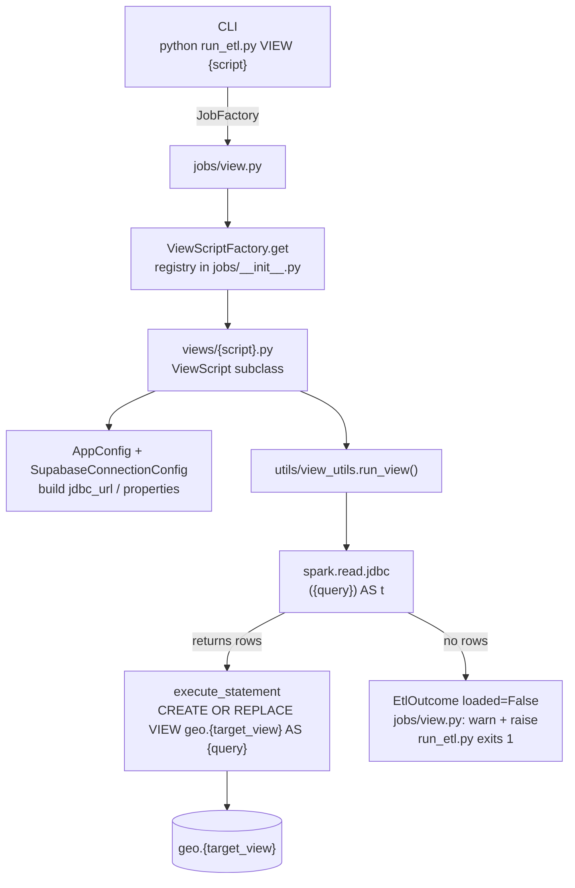

← [ETL jobs](../etl-jobs.md)

# VIEW job

`jobs/view.py` runs **one standalone PySpark script** from `views/` — a read → validate → define pipeline that turns a query over a `*_etl` table into a `*_vw` view. Each script is a `ViewScript` subclass (`views/view_script.py`) whose `run()` method delegates to the shared runner `utils/view_utils.run_view()`, fed the class's two object names and its query:



Unlike every other data job, the `VIEW` job needs **no `CREATE` run and no Pydantic model**: views are not tables, they are not registered in `TableFactory`, and the job itself stores the view definition in Supabase.

## Load type — HISTORICAL only

Views support exactly one load type:

| Condition | Load Type | Behavior |
|-----------|-----------|----------|
| Always | `HISTORICAL` | Re-runs the query over the `*_etl` source and replaces the whole view definition |
| Query returns no rows | `HISTORICAL` | Runner returns `loaded=False` → the job warns and raises `RuntimeError`, the existing view stays untouched |

A view has no `file_date` cursor to be incremental from, so there is nothing to detect or force: `--load-type` is rejected for this job the same way it is for every non-`SINGLE_ETL` job (`--load-type can only be used with the SINGLE_ETL job`). Details: [Load type detection — VIEW](load-types.md#view).

How the data flows:

1. `run_etl.py` parses the CLI args and resolves `JobType.VIEW` → `jobs/view.py` through `JobFactory`, passing the second positional argument as the **script name** — the file stem of a module in `views/` (e.g. `union_vw`).
2. `ViewScriptFactory` (`factory/view_script_factory.py`) looks that name up in its registry; scripts are registered by `jobs/__init__.py`. Unknown names raise `ValueError`.
3. `AppConfig.from_json()` and `SupabaseConnectionConfig.from_env()` build the JDBC URL and properties used by both database calls below.
4. `run_view` (`utils/view_utils.py`) executes the script's query through Spark's JDBC reader as a `(<query>) AS t` subquery — proving the SQL is valid and returns at least one row. A trailing `;` in the configured query is tolerated and stripped.
5. No rows → the runner returns `EtlOutcome(loaded=False, …)`; `jobs/view.py` warns with that summary and raises `RuntimeError`, so `run_etl.py` exits with code 1 (same contract as SINGLE_ETL) and **the existing view is not touched**.
6. Rows → `execute_statement` runs `CREATE OR REPLACE VIEW geo.<target_view> AS <query>` over JDBC. The definition is stored in the database, which recomputes the view on every read — so the view always reflects the current contents of its `*_etl` source.

The query lives entirely in `config.json` (`datasets.view.<script>`, the `ViewDatasetConfig` model) — the script itself is only wiring:

```json
"view": {
  "union_vw": {
    "source_table": "union_etl",
    "target_view": "union_vw",
    "query": "SELECT * FROM geo.union_etl WHERE source_name IS NOT NULL"
  }
}
```

`source_table` is the `*_etl` table the view reads (it must appear in the query, schema-qualified as `geo.<table>`), `target_view` is the `*_vw` name the job creates.

Log lines written to `logs/view/view_<view_name>_<timestamp>.log` (logger output — nothing is printed to the terminal):

```
INFO ---- View started: geo.union_etl → geo.union_vw ----
INFO Load type: HISTORICAL (the only load type views support)
INFO Running the query on geo.union_etl...
INFO Defining view geo.union_vw...
INFO View complete: geo.union_vw defined over geo.union_etl
INFO View union_vw complete — HISTORICAL: defined view geo.union_vw over geo.union_etl
```

An empty query result fails the run:

```
WARNING No records loaded into union_vw — query returned no rows from union_etl
ERROR ETL job failed   (RuntimeError)   → exit code 1
```

## Dropping a view

`run_drop_table.py` issues `DROP TABLE`, which PostgreSQL rejects for a view. Drop a view with SQL instead:

```sql
DROP VIEW IF EXISTS geo.union_vw;
```

The next `python run_etl.py VIEW union_vw` recreates it.

## Adding a new view script

1. Add a `datasets.view.<name>_vw` entry to `config.json` — `source_table` (the `*_etl` table), `target_view` (the `*_vw` name) and the `query` the view exposes. `ViewDatasetConfig` (`model/config/datasets.py`) already validates all three fields; no new model is needed unless the entry carries extra constants.
2. Create `views/<name>_vw.py`:

```python
from model.config.datasets import ViewDatasetConfig, load_dataset
from views.view_script import ViewScript

_cfg = load_dataset(__file__, "view", ViewDatasetConfig)


class UnionVwScript(ViewScript):
    SOURCE_TABLE = _cfg.source_table
    TARGET_VIEW = _cfg.target_view
    QUERY = _cfg.query
```

3. Register an instance in `jobs/__init__.py`:

```python
from views.<name>_vw import <Name>VwScript

_script = <Name>VwScript()
ViewScriptFactory.register(_script.TARGET_VIEW, _script)
```

4. Run it: `python run_etl.py VIEW <name>_vw`.
